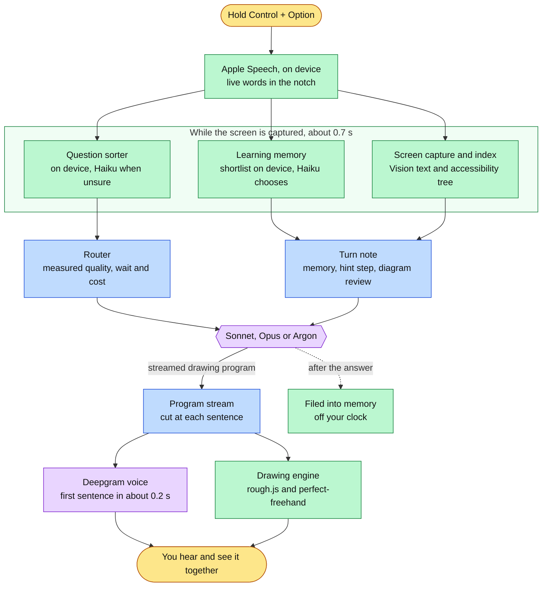

# Buddy

A study helper for macOS that sees your screen, explains out loud, and draws on what you are looking at while it talks. Hold Control + Option, ask about the LeetCode problem, the system design diagram or the code in front of you, and Buddy answers the way a friend at a whiteboard would: one sentence, the stroke that goes with it, the next sentence.

Buddy is a study helper, not a tutor. It never quizzes and never grades. It remembers what you have learned together, holds back the answer on practice problems until you ask for it, and talks through your own diagrams as a peer would.

Every design choice below was measured rather than assumed, and the scripts that measured it are in `scripts/`.

## What it does

| | |
|---|---|
| **Explains while drawing** | Answers are small drawing programs. Each spoken sentence arrives with its marks: rings, underlines and arrows on your real screen, and hand-drawn cards on calm space for pictures the screen does not have. The pen is paced to the voice. |
| **Lives in the notch** | Status, the sentence being said, and your own words live as you speak. Hover for the last lesson as a paper card, or the whole day's conversation. Idle, it disappears into the camera housing. |
| **Remembers what you learned** | Ideas explained in earlier sessions are recalled when a new question touches them, so an answer can build on Tuesday's lesson instead of starting over. Ideas you did not follow get a different example next time. Kept on your Mac only. |
| **Hints before answers** | On LeetCode, HackerRank and similar sites, help comes in steps: a nudge, the approach, a walk through by hand, then the code. You choose how far to go, and the code is always one sentence away. |
| **Reviews your own diagrams** | Drawing a design in Excalidraw, draw.io, Miro or Freeform, Buddy marks your own boxes and draws what it would add beside them, dashed and purple, so a suggestion reads as a suggestion. No score. |
| **Picks the right model per question** | Under Brain: Auto, quick questions go to Claude Sonnet, explanations to Gemini Argon, trade-offs to Claude Opus, each choice taken from a measured table of quality, wait and cost. |
| **Writes it all down** | Every question and answer is saved as a plain Markdown file per day, readable in any editor. |
| **Quiet sounds** | A soft tone when the mic opens and when a question is sent, a water drop when the notch opens. Never over the voice; one switch turns them off. |

## How it works



Green runs on the Mac, purple is a hosted model, blue is Buddy's own logic. The three steps in the box run at the same time, so sorting the question and recalling memory add nothing to the wait.

## Measured, not assumed

**Which model answers.** The three models raced on every kind of question, judged blind by two judges from different model families over two shuffled passes. Each kind goes to the model with the best quality once a second of silence before the first word is counted against it, and ties within the judges' noise go to the cheaper one. The routes held for any reasonable weighting of waiting and under either judge alone. Details in [docs/model-choice.md](docs/model-choice.md).

| Kind of question | Answered by | First word |
|---|---|---|
| Quick ("what's base 62?") | Sonnet | about 1.5 s |
| How or why something works | Argon | about 4 s |
| Teach me properly | Argon | about 4 s |
| "I didn't get that" | Argon | about 3 s |
| Should I use X or Y | Opus | about 6 s |

**Sorting the question.** On 100 spoken questions written by someone who never saw the examples, the on-device sorter alone was right on 33 of the 50 held out; with Claude Haiku deciding the uncertain ones it was right on 46, and never mistook a new question for "I didn't follow".

**Learning memory.** On 80 blind questions against 50 remembered ideas, scored on the held-out half: the full cascade found 32 of 33 relevant ideas at 91% precision and left 9 of 10 unrelated questions alone; names alone, used when Haiku is late or there is no key, found 16 at 94% precision. Shortlisting 5,000 ideas takes about 5 ms on the Mac. The choosing call takes 0.74 s at the median, inside the screen capture, for about $0.0006 a question. Filing a lesson costs about $0.002 and happens after the answer.

**Hints and diagram review.** Checked on a LeetCode problem and an Excalidraw design with both Sonnet and Argon: the first hint named no data structure and wrote no code, asking for the code gave it, a concept question on the problem page did not leak the solution, and the diagram review marked the student's own boxes, proposed a cache beside them and gave no score. 32 of 32 checks passed.

## How learning memory stays fast, small and current

Memory that grows forever and is searched while the student waits has three problems: it gets slow, it fills with duplicates, and it goes stale. Each is handled the way production agent memory handles it, on the Mac.

- **Fast.** Writing happens after the answer is spoken: Claude Haiku names the ideas the lesson taught, matches them to ones already known, and writes the plain-words phrases a student might use for each instead of its name ("charged twice" for an idempotency key), plus likely mishearings of the name. Reading is a single in-memory scan that reuses the vector already computed for sorting the question, so the expensive understanding is paid once at filing time, never while waiting.
- **Small.** A new explanation updates the idea it is about rather than adding a second copy, so the store grows with the number of ideas, not questions. Ideas met once and unseen for four months move to an archive and come back, history intact, if they come up again.
- **Current.** Each idea keeps only its latest explanation, so the tutor builds on what was last heard. How well it is probably still remembered follows the FSRS forgetting curve: fresh ideas are built on, fading ones get a one-sentence reminder, forgotten ones are taught again. If a macOS update changes the sentence model, stored vectors are re-embedded in the background.

Everything lives in `~/Library/Application Support/ClickyLocal/Memory` and can be switched off or forgotten in one click from Settings.

## Requirements

- macOS 14.2 or later, on Apple silicon
- Xcode 16 or later, to build
- At least one model provider:
  - an [Anthropic API key](https://console.anthropic.com/) for Claude Sonnet, Opus and Haiku, and
  - a Google Cloud project with Vertex enabled and the `gcloud` CLI signed in, for Gemini Argon
- Optional: a [Deepgram](https://deepgram.com/) key for the voice; without one the system voice speaks

With only an Anthropic key, Auto routes between Sonnet and Opus. With only Google Cloud, everything goes to Argon. With both, all three are used.

## Build and run

Once, create a local signing certificate, so macOS keeps the Screen Recording and Accessibility permissions across rebuilds: in Keychain Access choose **Keychain Access > Certificate Assistant > Create a Certificate**, name it `Clicky Local Dev`, set Identity Type to **Self Signed Root** and Certificate Type to **Code Signing**, and create it. Then:

```bash
git clone https://github.com/projects-hacks/clicky-studdy.git
cd clicky-studdy
zsh scripts/build-local.sh
```

The build script signs with that certificate, installs `/Applications/Buddy.app` and launches it.

Keys live in the macOS Keychain, never in the repository or the app. Each command below prompts for the key, so it never appears in shell history:

```bash
security add-generic-password -a api-key -s com.maverickrajeev.clicky-local.anthropic -U -w
security add-generic-password -a api-key -s com.maverickrajeev.clicky-local.deepgram -U -w
gcloud auth application-default login
```

On first launch macOS asks for Microphone, Screen Recording and Accessibility. The notch stays open on its settings tab until all three are granted. Diagnostics, including each raw model response and the timing of every stage, go to `~/Library/Logs/ClickyLocal.log`.

## Using it

- **Ask:** hold Control + Option, speak, let go. Your words appear under the notch as you talk.
- **Look back:** hover the notch for the last lesson, or switch to the transcript tab for the whole day.
- **Follow-ups:** tap the buttons under an answer to ask the next question it suggests, or copy the code it offers.
- **Clear:** Esc or Clear removes the drawing. Stop silences the voice.
- **Settings**, in the notch's gear tab: Brain (Auto, Claude, Gemini, Local), Sounds, and Learning memory with Forget all.

## Privacy

The screen is captured only while you hold the keys. Speech is transcribed on the Mac. The screenshot and the question go to the model that answers, and the question and short idea summaries to Claude Haiku for sorting and memory. Transcripts, memory and the hint ladder stay in `~/Library/Application Support/ClickyLocal`. Analytics are disabled.

## Project layout

| Path | What it holds |
|---|---|
| `leanring-buddy/` | The app. `CompanionManager.swift` runs the pipeline; `TutorControlBar.swift` is the notch; `ModelRouter.swift`, `LearningMemory.swift`, `PracticeHints.swift` and `DiagramReview.swift` are the features above. |
| `leanring-buddy/DrawingEngine/` | The drawing engine the answers run in. |
| `scripts/route_race/` | The model race, the blind judging and the routing table. |
| `scripts/question_sorting/` | The question sorter's calibration and its blind test. |
| `scripts/learning_memory/` | Memory's blind recall test, timing, and an end-to-end test of the real store. |
| `scripts/study_modes/` | The hint ladder and diagram review checks. |
| `docs/model-choice.md` | Every model decision and the numbers behind it. |

`AGENTS.md` is the detailed map of every source file.

## Credits

Buddy began as a fork of [Clicky](https://github.com/farzaa/clicky) by Farza, released under the MIT license, and has since been rebuilt around the notch, drawing programs, measured routing and learning memory. The hand-drawn look comes from [rough.js](https://roughjs.com/) and [perfect-freehand](https://github.com/steveruizok/perfect-freehand), both MIT.

## License

MIT. See [LICENSE](LICENSE).
