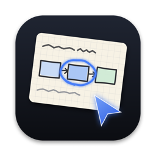
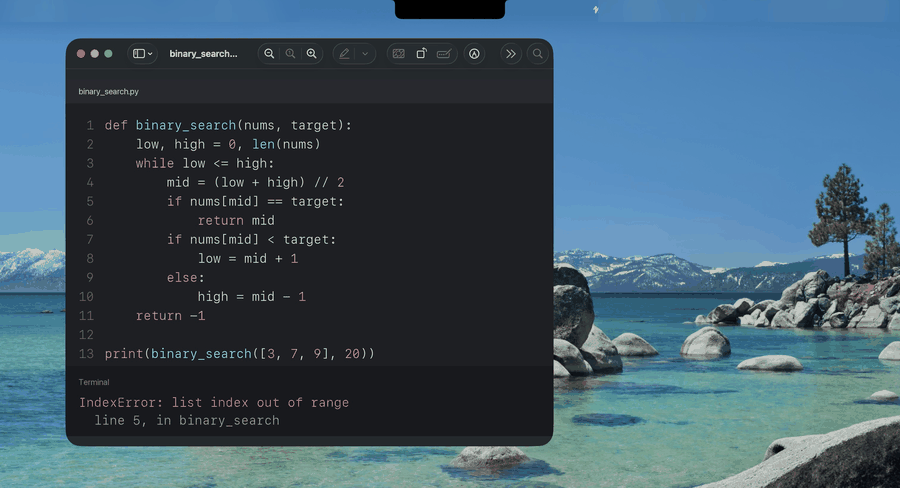
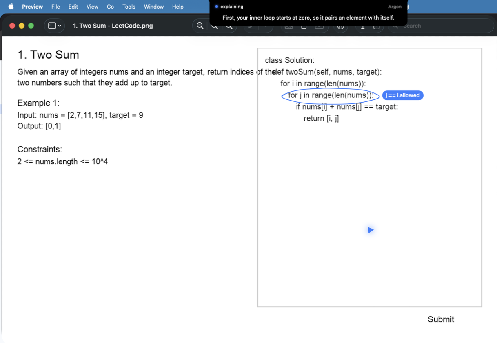
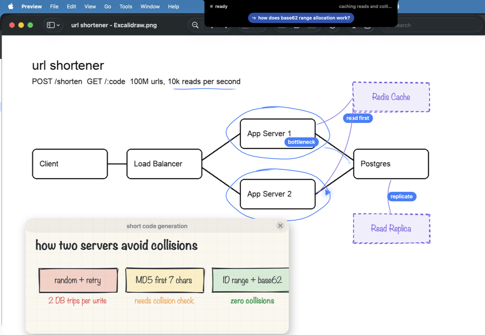
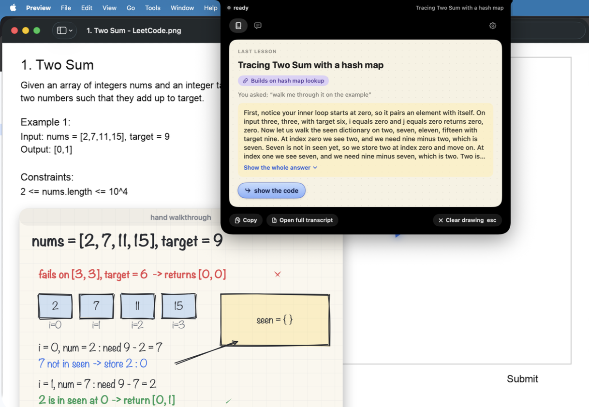
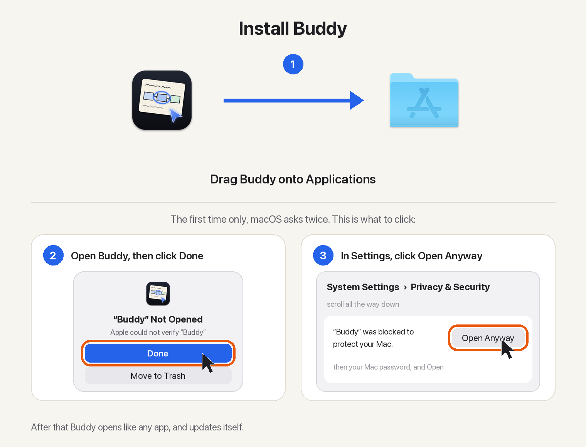

<p align="center">
  
</p>

<h1 align="center">Buddy</h1>

<p align="center">
  <b>A study helper in your Mac's notch.</b><br>
  Ask about what is on your screen. Buddy explains it out loud and draws on it while it talks.
</p>

<p align="center">
  <a href="https://github.com/projects-hacks/buddy/releases/latest"></a>
  
  
  <a href="LICENSE"></a>
  
</p>

<p align="center">
  <a href="https://github.com/projects-hacks/buddy/releases/latest/download/Buddy.dmg"></a>
</p>

<p align="center"></p>
<p align="center"><sub>A real answer, sped up. The words under the notch are what Buddy is saying.</sub></p>

## What it does

<table>
  <tr>
    <td width="33%" valign="top">
      <b>Explains and draws</b><br>
      <sub>Each sentence arrives with its marks: rings on your code, and hand-drawn cards for anything the screen does not show.</sub>
    </td>
    <td width="33%" valign="top">
      <b>Talk or type</b><br>
      <sub>Hold <kbd>⌃</kbd> <kbd>⌥</kbd> and speak, or press <kbd>⌃</kbd> <kbd>⌥</kbd> <kbd>T</kbd> and type in the notch.</sub>
    </td>
    <td width="33%" valign="top">
      <b>Walks you through apps</b><br>
      <sub>"How do I export this?" One step at a time, pointing at each button. Ask again later and it replays from memory.</sub>
    </td>
  </tr>
  <tr>
    <td valign="top">
      <b>Remembers what you learn</b><br>
      <sub>New answers build on earlier lessons. Stored on your Mac.</sub>
    </td>
    <td valign="top">
      <b>Hints before answers</b><br>
      <sub>On LeetCode and similar sites: a nudge, then the approach, then the code only when you ask.</sub>
    </td>
    <td valign="top">
      <b>Reviews your diagrams</b><br>
      <sub>In Excalidraw, draw.io, Miro or Freeform it marks your boxes and sketches additions beside them.</sub>
    </td>
  </tr>
</table>

Each question goes to Sonnet, Opus or Gemini Argon, whichever measured best for that kind of question, and Settings shows what you have spent today. A question costs one to six cents.

<table>
  <tr>
    <td width="33%"></td>
    <td width="33%"></td>
    <td width="33%"></td>
  </tr>
  <tr>
    <td align="center"><sub>A first hint, no solution</sub></td>
    <td align="center"><sub>A review of your own design</sub></td>
    <td align="center"><sub>A lesson that builds on an earlier one</sub></td>
  </tr>
</table>

## Install

<p align="center"></p>

The download window shows these same steps. macOS asks for **Open Anyway** once, because Buddy is not notarized. Setup then asks for your name and keys and walks through three permissions; after that Buddy updates itself.

<p>
  <a href="https://console.anthropic.com/settings/keys"></a>
  <a href="https://aistudio.google.com/apikey"></a>
  <a href="https://console.deepgram.com/"></a>
</p>

Step by step, with troubleshooting: [docs/install.md](docs/install.md).

## Using it

| Keys | Does |
|---|---|
| Hold <kbd>Control</kbd> + <kbd>Option</kbd> | Ask out loud; your words show under the notch |
| <kbd>Control</kbd> + <kbd>Option</kbd> + <kbd>T</kbd> | Type a question; <kbd>Return</kbd> sends, <kbd>Shift</kbd> + <kbd>Return</kbd> adds a line |
| Hover the notch | The last lesson, the day's chat, Settings |
| <kbd>Esc</kbd> | Clear the drawing, or stop a walkthrough |

More in [docs/using-buddy.md](docs/using-buddy.md).

## How it works


The model answers with a short drawing program, and the first sentence is spoken while the rest is still being written. Details in [docs/how-it-works.md](docs/how-it-works.md).

## Results

<table>
  <tr>
    <td align="center" width="25%"><h3>46 / 50</h3><sub>spoken questions sorted by kind, held out<br>(33 with the on-device model alone)</sub><br><sub><code>scripts/question_sorting</code></sub></td>
    <td align="center" width="25%"><h3>32 / 33</h3><sub>relevant past lessons recalled, 80 blind questions<br>(16 matching names alone)</sub><br><sub><code>scripts/learning_memory</code></sub></td>
    <td align="center" width="25%"><h3>32 / 32</h3><sub>hint and diagram review checks<br>on Sonnet and Argon</sub><br><sub><code>scripts/study_modes</code></sub></td>
    <td align="center" width="25%"><h3>0 / 49</h3><sub>near misses replayed as the wrong how-to<br>(30 of 40 new phrasings found)</sub><br><sub><code>scripts/howto</code></sub></td>
  </tr>
</table>

The model for each kind of question was chosen by a blind-judged race of all three: [docs/model-choice.md](docs/model-choice.md).

## Privacy

| What | Where it goes |
|---|---|
| **Screen** | Captured only when you ask, or after a click while a walkthrough waits; those checks are compared on the Mac and discarded |
| **Voice** | Transcribed on the Mac |
| **Sent** | The screenshot and question, to the model that answers |
| **Kept** | Transcripts, memory and how-tos in `~/Library/Application Support/Buddy`; keys in the Keychain |
| **Analytics** | None |

<details>
<summary><b>Building from source</b></summary>
<br>

Needs Xcode 16 and a self-signed code signing certificate named `Clicky Local Dev` (Keychain Access > Certificate Assistant > Create a Certificate, Self Signed Root, Code Signing). The name predates Buddy and has to stay: installed copies only accept updates signed with it.

```bash
git clone https://github.com/projects-hacks/buddy.git
cd buddy
zsh scripts/build-local.sh
```

Logs go to `~/Library/Logs/Buddy.log`. Releases: [docs/releasing.md](docs/releasing.md). Source map: [AGENTS.md](AGENTS.md). Tests: [scripts/](scripts/README.md).

</details>

## Credits

Started as a fork of [Clicky](https://github.com/farzaa/clicky) by Farza (MIT). Drawing uses [rough.js](https://roughjs.com/) and [perfect-freehand](https://github.com/steveruizok/perfect-freehand) (MIT). Licensed under [MIT](LICENSE).
