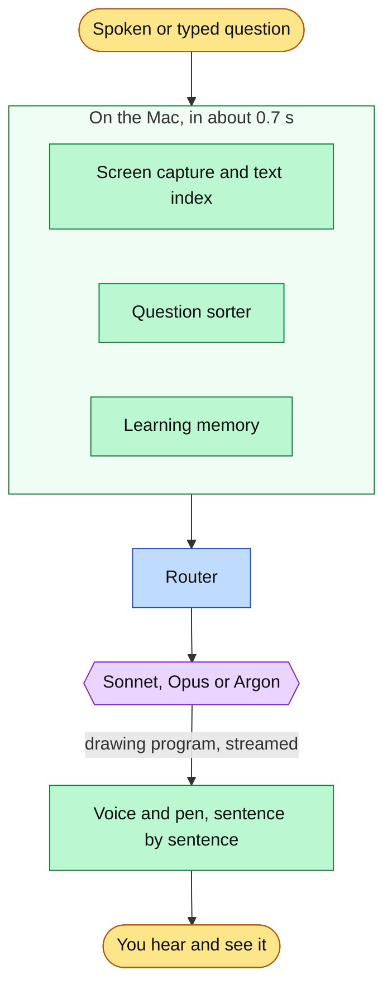

# Buddy

A study helper for macOS that lives in the notch. Ask about what is on your screen, out loud or typed, and Buddy explains it out loud while drawing on it: rings and arrows on your code or diagram, and hand-drawn cards for anything the screen does not show. It also walks you through apps you are new to, one step at a time.

<p align="center"></p>

## Download

<p align="center">
  <a href="https://github.com/projects-hacks/buddy/releases/latest/download/Buddy.dmg"></a>
</p>

macOS 14.2 or later, Apple silicon or Intel. The download window shows the three install steps; macOS asks once for **Open Anyway** because Buddy is not notarized. Setup then asks for your name and keys and walks through three permissions. After that Buddy updates itself.

Buddy uses your own keys: [Anthropic](https://console.anthropic.com/settings/keys) (recommended), and optionally [Gemini](https://aistudio.google.com/apikey) and [Deepgram](https://console.deepgram.com/) for a better voice. A question costs one to six cents. Help with install: [docs/install.md](docs/install.md).

## What it does

- **Explains and draws at once.** Each spoken sentence arrives with its marks, paced to the voice.
- **Talk or type.** Hold Control + Option to speak, or press Control + Option + T to type in the notch.
- **Walks you through apps.** Ask "how do I export this?" and it points at each button, waits for you to click, and gives the next step.
- **Replays tasks it has shown you.** The same request again, in other words, is walked through from memory without a model call.
- **Remembers what you learned.** New answers build on earlier lessons. Stored on your Mac.
- **Hints before answers.** On LeetCode and similar sites: a nudge, then the approach, then the code only if you ask.
- **Reviews your diagrams.** In Excalidraw, draw.io, Miro or Freeform it marks your boxes and sketches additions beside them. No score.
- **Picks a model per question.** Sonnet, Opus or Gemini Argon, from measured quality, wait and cost.
- **Shows what it spends.** Today's and this month's spend on your keys, in Settings.

<p align="center">
  
  
</p>

## Using it

| | |
|---|---|
| Hold Control + Option | Ask out loud |
| Control + Option + T | Type a question (Return sends, Shift + Return adds a line) |
| Hover the notch | Last lesson, the day's chat, Settings |
| Esc | Clear the drawing, or stop a walkthrough |

More in [docs/using-buddy.md](docs/using-buddy.md).

## How it works



The model answers with a short drawing program; the first sentence is spoken while the rest is still being written. Details in [docs/how-it-works.md](docs/how-it-works.md).

## Results

| What | Result | Test |
|---|---|---|
| Model per kind of question | Chosen by a blind-judged race of all three models | [docs/model-choice.md](docs/model-choice.md) |
| Question sorting | 46 of 50 held-out spoken questions sorted correctly | `scripts/question_sorting/` |
| Learning memory | 32 of 33 relevant ideas found on 80 blind questions | `scripts/learning_memory/` |
| Hints and diagram review | 32 of 32 checks passed on Sonnet and Argon | `scripts/study_modes/` |
| How-to replay | 30 of 40 new phrasings found; 0 of 49 near misses replayed | `scripts/howto/` |

## Privacy

- The screen is captured only when you ask, or after each click while a walkthrough waits for you. Those checks are compared on the Mac and discarded.
- Speech is transcribed on the Mac. The screenshot and question go to the model that answers.
- Transcripts, memory and how-tos stay in `~/Library/Application Support/Buddy`. Keys stay in the Keychain. No analytics.

## Building from source

Needs Xcode 16 and a self-signed code signing certificate named `Clicky Local Dev` (Keychain Access > Certificate Assistant > Create a Certificate, Self Signed Root, Code Signing). The name predates Buddy and has to stay: installed copies only accept updates signed with it.

```bash
git clone https://github.com/projects-hacks/buddy.git
cd buddy
zsh scripts/build-local.sh
```

Logs go to `~/Library/Logs/Buddy.log`. Releases: [docs/releasing.md](docs/releasing.md). Source map: [AGENTS.md](AGENTS.md). Tests: [scripts/](scripts/README.md).

## Credits

Started as a fork of [Clicky](https://github.com/farzaa/clicky) by Farza (MIT). Drawing uses [rough.js](https://roughjs.com/) and [perfect-freehand](https://github.com/steveruizok/perfect-freehand) (MIT).

## License

MIT. See [LICENSE](LICENSE).
