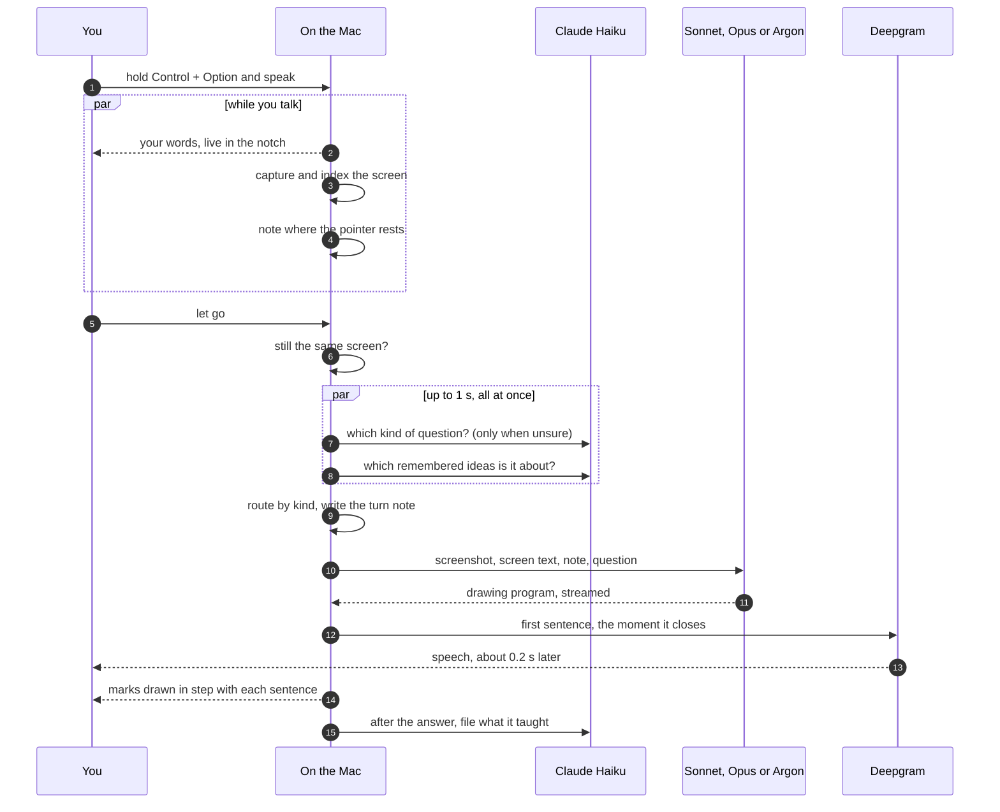
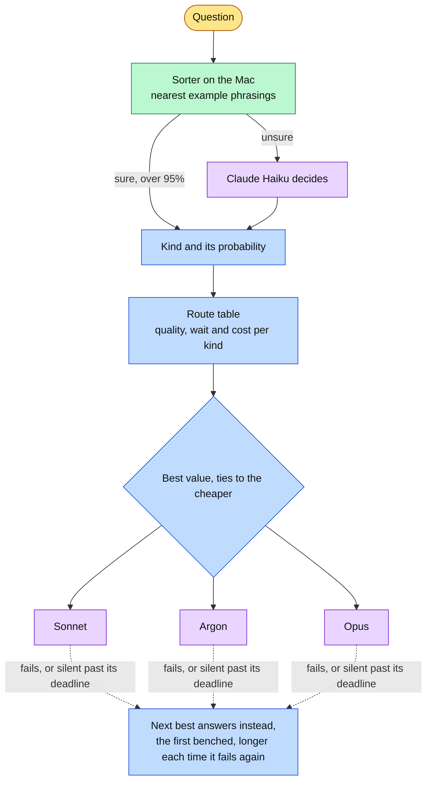
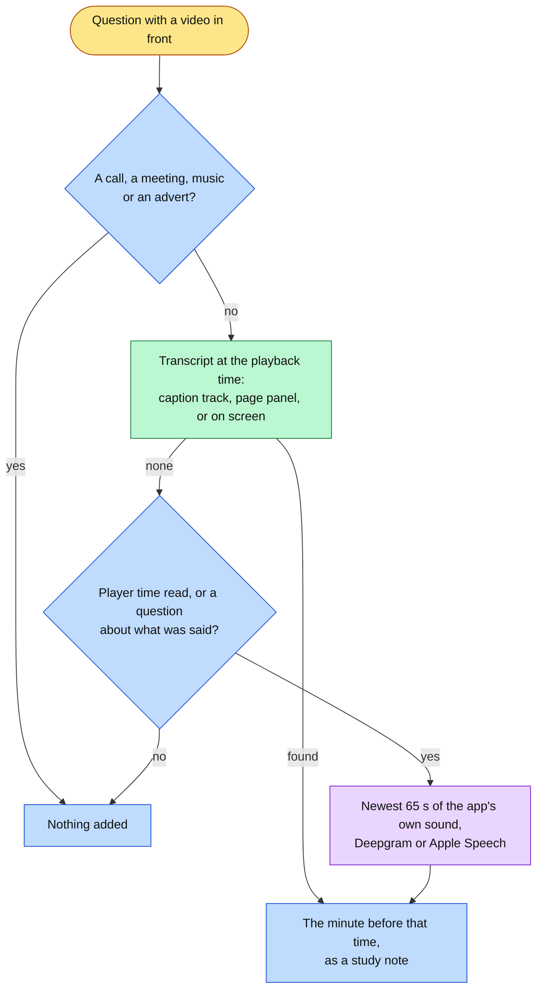
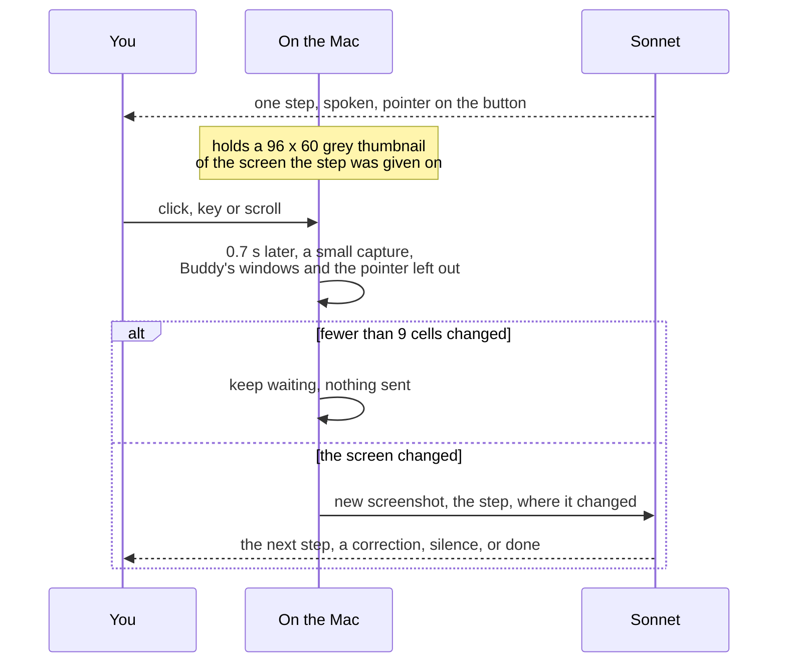

# How Buddy works

What happens between asking and hearing the first sentence, and how each feature stays out of that wait.

## One question, start to finish

Everything that is not the answer itself runs while the student is still talking, inside the short window after release, or after the answer is spoken. The screen is read during the talking; the question's kind and the remembered ideas are settled within a second of the question; the only open wait is the model's first sentence.

A typed question (Control + Option + T, or the chat box) joins at step 7: there is no speech and no early screen, so the screen is captured then. The chat box lives in the notch, which is a non-activating panel, so typing in it never takes the front away from the app being studied; the screen read and the app named in the turn note are still that app's.

## The answer is a program

The model does not answer in prose. It writes a small JavaScript program in beats: `say("...")` for a spoken sentence, then the marks drawn while it is said, such as `ring("t35")` around a line of code on the real screen, or `paper(...)` for a hand-drawn card on calm space. The program streams, so the first sentence is spoken while the rest is still being written, and each sentence's strokes are paced across its audio.

Screen marks name things by id from the screen index, a numbered list of every piece of text on screen with its exact box, built from Apple Vision and the accessibility tree. That is what lets "the third line" land on the third line.

## The screen, read while you talk

Pressing Control + Option starts a screen capture straight away (`EarlyScreenCapture.swift`). The display holding the pointer is captured and indexed into an index of its own, so a capture that is thrown away leaves the one the app is using untouched. The few seconds of talking were dead time; now they hold the capture and the recognition, which used to come after release (0.35 to 0.55 s in the log, `CompanionManager+QuestionKind.swift`).

The risk is answering about a screen that has gone. So at release, while the last words are transcribed, the early capture is checked on the Mac against the screen as it is now: the same app and window in front with the same title and frame, the pointer on the same display, and a 96 x 60 grey thumbnail with fewer than 9 changed cells, the comparison guide mode uses. Any difference throws it away and the screen is captured again, as before. A capture no question claims (a tap of the keys, Control + Option + T, Esc, nothing heard) is dropped. Nothing is written to disk.

What "this" means comes from the same press (`StudentPointing.swift`). Text selected in the app in front is read from the accessibility tree when the question arrives. Otherwise the pointer counts only where it rested: still for 0.4 s or more on a listed screen item while the keys were held, sampled every 50 ms. Either one becomes one line of the turn note naming the id. With neither, the note is unchanged, so the prompt cache and the answers are too. A pointer rest is used only when the early screen was used, because a screen read again no longer matches where it rested.

## Choosing the model

The route table comes from racing all three models on every kind of question and having two judges from different model families score the answers blind. The race, the judging and the sensitivity of the choice to how much waiting is worth are in [model-choice.md](model-choice.md).

A brain's deadline is twice its usual time to the first word for the question's kind, at least 8 s and at most 30 s (`ModelRouter.swift`). It applies only when there is another brain to hand over to. A brain that fails or stays silent is benched for five minutes; if it fails again as soon as it is back, each time doubles the bench, up to an hour, and one answer from it clears the count. Otherwise every question would pay for its attempt and then the next brain's, and wait out the whole deadline first. Board turns are routed differently; see The teaching board below.

## Draw only when it helps

Not every answer needs a drawing. The system prompt (`TutorProgramPrompt.swift`) says to mark the screen when the answer is about something on it, to open a card only when a picture teaches what words do not, and to draw nothing for small talk or a fact unrelated to the screen. The length rule for a quick question says the same: one or two beats, no card.

Measured in `scripts/draw_judgement/` on sixteen questions with Sonnet: 15 of 16 drew what was expected, against 12 of 16 before the rule (the 1.5 prompt marked the screen for a pronunciation, a history fact and a thank you). Mean output was 539 tokens, against 557 to 595 before. Cards are kept, since they cost the most and teach the most; the saving is the clutter on answers that needed none.

## Talking over Buddy

While an answer plays, the microphone is open and the notch shows a mic glyph beside "explaining" (`TalkOverListener.swift`). It opens when an answer starts and closes when the answer ends, or on Esc or Stop. It is never open while the talk keys are held, and never on a Bluetooth headset, whose microphone would drop the whole answer to call quality. There is no switch, as for lecture mode and the error offer: the microphone is open only while Buddy is talking, and always shown.

Buddy's own voice comes back into the microphone, so the transcript holds its words and the student's interleaved. The reading half (`TalkOverHearing.swift`, pure so it is checked offline) keeps the last 8 s of heard words with their arrival times. Runs of words that follow one of Buddy's recent sentences in order (the one being said and the two before it), while that sentence's echo can still arrive (up to 2 s after it ends), are taken out. What is left is the student.

- **A cue** among the student's words (wait, hold on, hang on, sorry, but why) pauses Buddy at once. "Wait" alone counts as a hold only after 1.5 s with nothing after it, because it is also how most questions cutting in start.
- **Commands** must be the whole of what was heard: go on resumes, slower slows the rest (Deepgram's `speed` for sentences not yet fetched, a pitch-keeping time stretch for audio already downloaded), go back says the last sentence again, and say that again replays the whole answer.
- **A question** must be loud enough to be the person at the Mac (-40 dBFS), addressed to Buddy, 3 to 40 words (two when opened by a cue, as in "wait, why?"), and not an echo. It stops the answer and is answered with the cut-off answer as context. Once Buddy has paused, the end of the question is read from the microphone (1.2 s below speech level), then the recognizer is asked for its final words.

Hearing costs nothing extra without a Deepgram key (Apple Speech on the Mac). With one, the audio goes to Nova-3 while an answer plays, about $0.009 a minute, counted in the meter. `scripts/talk_over/` plays recorded overlaps through the same code on a simulated clock: a live cut-in with Buddy's words glued on, a hold, a question with no cue, a video in the room, and Buddy's voice alone.

## Say that again, with no model

The last answer heard is kept in memory (`AnswerRecording` in `LessonProgramPlayer.swift`): its program, each sentence's audio, the boxes it drew on and a thumbnail of the screen at the time. "Say that again", the notch's Replay and the Notebook's Replay play it back through the same engine with no model call and no speech request, so a replay costs nothing. It is not counted as a question or filed into memory.

Before replaying, the screen is compared with the thumbnail. If fewer than 9 cells changed, the marks on the screen's content are drawn again; otherwise only the cards and the voice are replayed, since marks on content that moved would point at the wrong thing.

## Marks that follow the content

Marks are drawn on a screenshot, and the content under them moves. `MarkFollower.swift` keeps them on their items with no model:

- **A window dragged or resized**: the marks follow its frame, read from accessibility notifications as it moves. After a resize, which can reflow the content, the items are found again.
- **A scroll**: the marks move with the trackpad's deltas. 200 ms after it stops, only that window is captured and recognised, and each marked item's text is found again near where it should be. Of several copies, only the nearest is taken, and only if it is near; a mark never jumps to a far duplicate. Marks whose item left the view fade, and return when it does.
- **A window covered, on another Space, or hidden**: its marks are hidden until it is back.

Nothing runs while nothing moves: window moves arrive as notifications, and the one recognition pass happens after a scroll or resize has stopped.

## Lecture mode

When the student asks while a video lecture is in front, the tutor gets the lecturer's last minute as a study note (`LectureMode.swift`). There is no switch; with no lecture in front it adds nothing.

**Transcript first.** The playback time is read from the player ("12:34 / 48:10", or a seek bar's description). The lines before it come from YouTube's caption track, then a transcript panel in the page read through the accessibility tree (YouTube's Show transcript, Coursera's), then the same panel recognised on the screenshot. YouTube now usually withholds the caption track, so the panel is the common source. The page read is bounded to 6,000 elements and 1.2 s (`LecturePageReader.swift`).

**The sound as a fallback.** When no transcript can be placed, a Core Audio process tap on the front app and its helper processes, never the microphone, keeps the last 90 s in memory (`LectureAudioBuffer.swift`). It runs only while that app plays sound and is not a call (any app using a microphone counts as one), a meeting or a music app, and is emptied on every app switch. The notch shows a small glyph whenever it runs.

**The gate.** The sound is sent only for a lecture question: a player's time was read, or the question is about what was said ("what did he mean", "the lecturer") (`LectureAudioGate`). Then only the newest 65 s are transcribed, by Deepgram Nova-3 at $0.0077 a minute of audio sent, or by Apple Speech on the Mac without a key.

It gathers while the screen is read and waits at most 3 s from the question. The permission, System Audio Recording, is asked once, at the first question where the sound would have helped; macOS offers no way to read it, so a refused tap hears silence and is treated as nothing to add. `scripts/lecture_mode/` checks time reading, transcript finding, the exclusions, the minute before a time on real lecture captions, and the buffer, offline.

## Explain this error?

When an error appears in front of the student, a soft red halo glows under the notch for 20 seconds and the notch says "An error on screen." Hovering opens the error card; Explain this error, or a press of the talk keys without speaking, accepts.

**Watching is event driven** (`ErrorWatcher.swift`). It listens only while a terminal, an editor, Xcode, or a browser on a judge's page (or a separate developer tools window) is in front. Return, a run, build or test shortcut, or a click starts it. It waits for the front window to change and hold still for 600 ms, then reads only that window, at most once every 3 s: Terminal and iTerm2 through their accessibility text, anything else by text recognition on the rows that changed. With none of those apps in front there is no monitor, no timer and no work.

**Recognition is by shape** (`ErrorRecognizer.swift`): the frame a Python traceback, a Java or JavaScript stack, rustc, clang, a Go panic, pytest, Jest, JUnit or XCTest prints, or a judge's verdict, never the word "error". A fingerprint stops the same error glowing twice.

**No model call until accepted.** Accepting sends "explain this error" through the normal pipeline with a turn note naming the error's lines and their screen index ids, so the answer rings the line it points to. It never glows while Buddy answers, guides or listens, in a readable Focus, or more than once a minute.

Measured in `scripts/error_offer/`: the fresh set's first run glowed for 18 of 20 errors with 0 false glows in 18 near misses, and 20 of 20 after fixing the two formats it missed; the set the patterns were written against, 57 of 57 with 0 of 55. Reading only the changed rows costs 41 ms of CPU per read (median, M4), the recognizer 0.2 ms a check, and comparing thumbnails 0.4 ms.

## The teaching board

"Teach me X from scratch" turns the whole display into paper and teaches on it over several turns (`TeachingBoardSession.swift`). `BoardIntent.swift` decides on the Mac whether a question opens it: a named topic from scratch, nothing pointing at the screen. Precision matters most, because opening the board takes away the screen the student may be asking about; on a blind set written after the rules were tuned, its first look scored precision 0.972 at recall 0.875 (`scripts/board/`).

**The model edits a board, it does not draw one.** The board lives in Swift (`BoardState.swift`): elements with stable ids, arrows, which turn added each. The model writes `board.*` operations against those ids (`board.box`, `board.link`, `board.update`, `board.append`, `board.highlight`, `board.remove` and a few more); adding an id that exists updates it, so the model cannot redraw by accident. Each program piece's board calls are applied on the Mac (`TeachingBoard.swift`) and replaced in place with exact strokes before the engine runs them, so the strokes stay with the sentence before them.

**Layout is on the Mac** (`BoardLayout.swift`): words measured in the engine's own font, placement into free space without moving anything, arrows routed around elements, labels that touch nothing. The model never sees a coordinate. On the Sonnet answers drawn with the final layout, `overlap_check.py` found 0 overlaps in 15 boards.

**Its own cached prompt** (`BoardProgramPrompt.swift`), 2,324 tokens, leaves the normal prompt and its cache untouched. The turn note is the board's ids and words, the length and the question: 574 tokens for a 20-element board with 7 arrows. There is no screenshot; learning memory's recall is in the note.

**Sonnet first under Auto.** A teach question goes to Argon under Auto, but a board turn goes to Sonnet first whenever there is an Anthropic key, with Argon as the fallback. On the board's long prompt Sonnet took 3.6 to 8.8 s for a whole turn (median 4.8) and Argon 6.9 to 59.1 s (median 12.6), with HTTP 429 mid-session; a five-turn session cost $0.051 on either. Under the Gemini or Claude settings the student's choice holds.

Esc, "done", Leave board or ten idle minutes close it. The whole board lesson is filed into memory as one lesson and kept in the Notebook as one page.

## Teach it back

"Let me explain X back to you" opens the same board titled "You explain: X" and listens hands free (`TeachBackListener.swift`): a red meter, and it ends on "I'm done", Return, eight seconds with no new words, or three minutes. Bluetooth headsets are allowed here, since no answer is playing.

Then two calls, both through the board's routing (`TeachBackPrompt.swift`):

1. **The student's version.** A faithful scribe: only what was said, wrong claims as stated, in their words, drawn in the student's purple ink (`BoardInk.student`) as one beat.
2. **The gaps.** At most four marks on their drawing in dashed red (`BoardInk.gap`): a missing part, a missing link, or a red ring with the correction beside it. While the gap pen is on, the board refuses any change to the student's drawing, gives a fresh id to a mark that reuses one of theirs, and stops at four.

What they got right strengthens those ideas in memory as a successful review; what they missed counts as lost.

Faithfulness is measured in `scripts/teach_back/` on fourteen spoken explanations with deliberate errors and omissions, on Sonnet 5.5 with the app's prompts and board: 0 invented parts, 74 of 74 parts drawn, 15 of 15 wrong claims kept as stated, and 24 of 24 planted gaps found, with 34 marks in all. Both calls cost about $0.0065 a fixture.

## The notebook

Every finished lesson becomes a page (`NotebookRecorder.swift`), written only when the answer ends uncancelled; a new question drops the one being held. Guide steps and how-to replays are never kept; a prose answer is a page of words; a board lesson or teach-back is one page when the board is left.

Pages are plain files, one folder per lesson under `Notebook/<day>/<time-id>/` (`NotebookStore.swift`): `page.json`, written last so a half-written page is never shown and is swept away; `card-N.svg` for each card; and `screen.jpg`, only the marked region, cut from a capture of the display at its own pixels taken beside the model's 1280 px screenshot (held in memory only, never sent), at most 1600 px, with the marks drawn over it. Cards stay vectors because the engine already draws SVG; `notebook-snapshot.js` copies them out in an isolated content world and strips anything that is not a drawing (scripts, links, external images, event attributes). On the sample in `scripts/notebook/`, a drawn lesson is 92 to 146 KB and a prose one 1.1 KB; cut from the model's screenshot instead, code in the picture was stretched about 1.6 times on a Retina display and read soft.

**The PDF** (`NotebookPDFExporter.swift`) is the pages laid out as HTML into paper-sized sheets, A4 or US Letter by region, so a card is never cut. Each sheet is printed with WebKit's `createPDF`, keeping text and drawings vector, and the sheets are joined with PDFKit off the main thread. It runs in the background and ends with a notification with Open PDF; permission is asked at the first export, and if it is refused the notch shows the result instead.

## The map of what you know

The Map window draws every remembered idea, how they link, and how well each is probably remembered.

**Relations** come from the filing call that already runs after every answer: `LessonConceptPrompt.txt` asks for a short `related` list against the known ideas it was shown, so there is no extra call per lesson. Filing went from $0.0018 to $0.0020 a lesson. Stores from before relations get them once, in the background, the first time the map is opened: one Haiku call per 20 ideas with `ConceptRelationsPrompt.txt`, names and one-sentence summaries only (`KnowledgeMapRelations.swift`). Both replies are read strictly: a link counts only if its kind is one of five (uses, part of, alternative to, prerequisite of, contrasts with) and both ids were in what Haiku was shown, so a misread id can drop a link but never invent one. On a fixture written before the prompts were run, filing found 12 of 12 expected links and the one-time pass 18 of 18, with no links to unrelated ideas (`scripts/knowledge_map/`).

**Layout is on the Mac** (`KnowledgeMapLayout.swift`), pure and repeatable: clusters from relations and shared lessons, a force layout per cluster seeded from ids, unlinked ideas in a sunflower, no overlapping dots or names. 0.1 ms for 5 ideas, 0.6 ms for 40, 5 ms for 300 (M4), and the same ideas give the same map every time.

**Strength** is each idea's FSRS retrievability, in the bands the tutor's note uses: Strong at 85% or more, Fading from 60 to 85%, Time to review below 60%.

## Hints and diagram review

Both are notes added to the turn, never to the cached system prompt, so the prompt cache holds.

- **Practice problems** are recognised by the window (LeetCode, HackerRank and others) or by a page with an example, constraints and a submit button. What was said decides the rung asked for, the program reports the rung it gave with `hintLevel(n)`, and the rung is kept per problem for two days.
- **Diagrams** are recognised by the drawing tool in front, or by the student saying it is their own design. The tutor marks their boxes by id and proposes additions with `suggest(...)`, drawn dashed and purple beside them.

Both were checked on Sonnet and Argon with drawn screens: 32 of 32 checks passed (`scripts/study_modes/`).

## Guide mode

When the question is a task in an app ("how do I export this"), the answer gives only the first step and ends with `waitForStep("click Export as PDF", "a save dialog")`. There is no switch: the model decides from the question, and a question that is not a task never starts one.

The watching costs no tokens: nothing is captured without input from the student, and the comparison is a few thousand subtractions on the Mac. The model is asked again only when the screen visibly changed, which is one ordinary answer, about a cent with Sonnet. The note tells it where the change was, so a menu that just opened is read as the step done. Switching to an app the step does not name is not counted, the menu bar clock is ignored, and a guide ends on Esc, Stop, a new question, 15 steps or 5 minutes without progress. Guide steps are not filed into learning memory; "click Export" is not an idea.

Menu bar titles and an open menu's items are kept in the screen index, which otherwise drops everything outside the front window as chrome, so a step can point at File and then at Export as PDF by id.

## How-tos: replayed with no model

A walkthrough that reaches the end of its task is kept (`HowToMemory.swift`): each step's sentences, the label of the control it pointed at, and what it waited for. Labels rather than ids, because ids are new on every screen and "Export as PDF…" is what is still there tomorrow. When it is kept, one Haiku call (about $0.0001) names the task and writes ten ways a person might ask for it.

A new question is checked against the saved how-tos before anything is paid for, on the Mac: the same app, a question that asks how to do something, and a saved phrasing that shares nearly all of its words both ways. Meaning from the on-device sentence model rates every short how-to question alike, so it is only a floor; the words decide, and the steps' own words are left out of them. Measured in `scripts/howto/` on eight tasks across seven apps: 30 of 40 fresh rephrasings found, and none of 49 near misses ("save as PNG" for "save as PDF", "turn off dark mode" for "turn on") ever replayed.

A match skips the question sorter, memory and the model. The screen is read, the first step's control is found by its label, and the saved step is spoken and drawn through the same engine. Each later step is replayed once the student has done the previous one and its control has appeared. A control that is not there means the app is different from last time: the model is told what was already done and carries on from that step, and the walkthrough it gives replaces the saved one.

## Learning memory

Three problems come with memory that grows forever and is read while someone waits.

- **Speed.** The hard part, understanding what an idea is and how a student might describe it without its name, happens once, at filing time: Haiku writes the plain-words cues ("charged twice" for an idempotency key) and likely mishearings ("item potent"). Reading is then a single in-memory scan, about 5 ms over 5,000 ideas, plus a Haiku choice that runs inside the capture.
- **Growth.** A new explanation updates the idea it is about instead of adding another copy, so the store grows with ideas, not questions. Ideas met once and unseen for four months move to an archive and return, history intact, when they come up again.
- **Staleness.** Each idea keeps only its latest explanation. How well it is probably remembered follows the FSRS forgetting curve, which decides whether the tutor builds on it, gives a one-line reminder, or teaches it again. Vectors are tagged with the sentence model that made them and re-made in the background if a macOS update changes it.

Measured on 80 questions written by someone who never saw the code: on the held-out half the cascade found 32 of 33 relevant ideas at 88 to 91% precision across repeated runs and left 9 of 10 unrelated questions alone. The tests are in `scripts/learning_memory/`.

## When things go wrong

Each guards against a hang, a crash or a silent answer.

- **Sleep and wake.** Going to sleep stops the answer, cancels listening and closes the talk-over microphone, rather than letting every stream fail on waking. Waking rebuilds the output audio engines on whatever device exists now, restarts the key taps, clears a Deepgram voice failure from while asleep, and probes the brain again (`CompanionManager+Interruptions.swift`).
- **Displays.** A display added or removed rebuilds the cursor overlay, one window per screen, and ends a guide or marks on a display that is gone.
- **Audio device changes.** Headphones, or a microphone opening in call mode, stop an `AVAudioEngine`. The voices notice the change, end the cut sentence and start the engine again on the next one, instead of playing into a stopped engine. The talk-over and teach-back microphones rebuild their tap on a format change, and lecture mode rebuilds its tap when the default output changes.
- **A sentence that never finishes.** Each voice waits for a sentence's audio at most the time left in it plus 5 s, then moves on and restarts its engine; the prose path caps a sentence at 45 s. A Deepgram voice failure falls back to the system voice for five minutes, not for good.
- **A silent or failing brain.** A brain that has said nothing by its deadline (see Choosing the model) or fails before speaking hands the question to the next one and is benched for five minutes, so the next question does not wait on it too. When the Anthropic key is the problem, Opus and Sonnet are skipped together. With nobody to hand over to, a busy brain is asked once more after a short random pause. An answer whose stream goes quiet for 20 s after its first words is ended as stalled. Offline, a question fails at once and says so.
- **A drawing program that hangs.** A piece of the program normally runs in milliseconds. The engine makes loops check the clock and stops a piece after 2.5 s; the app gives up at 3 s and rebuilds the page. A page that does not load in 10 s, or whose web content process ends, is rebuilt too (`DrawingOverlay.swift`).
- **A busy app.** Every accessibility call is a message to another app, and a hung one can take seconds. The screen index walks the tree off the main thread, each call gives up after 0.25 s, and the walk stops at 2,000 elements or 0.3 s (`ScreenIndex.swift`). The key taps run on a thread of their own, so work on the main thread never delays typing or gets the tap switched off for being slow.
- **The keys.** A release macOS never reported is caught by reading the real key state, and a recording ends after two minutes.
- **What is left behind.** A main thread blocked longer than 2 s is logged with the last entry before it, as is any uncaught exception. Each launch keeps the previous session's log, and a log past 5 MB is moved aside.

## What it spends

`SpendingMeter.swift` adds up what each paid call reports: the token counts in every Claude and Gemini reply, priced at the published rates in one table (Argon's introductory price doubles on 1 December 2026, and the meter changes with it), Deepgram's per-character price for every sentence spoken, and its per-minute price for listening (a question, talking over an answer, teaching back, a lecture's sound). It only listens: it reads the numbers after a reply has arrived, never delays or changes an answer, and saves a moment later off the main thread. Kept per day in `spending.json`.

## Where things live

All under `~/Library/Application Support/Buddy` unless a full path is given.

| What | Where |
|---|---|
| Keys | macOS Keychain, saved and read through `/usr/bin/security` so updates never prompt |
| Transcripts | `Transcripts/`, one Markdown file and one JSON Lines event file a day |
| Memory and the map's links | `Memory/`: `concepts.json` (each idea with its links), `archive.json`, `vectors.bin`, `lessons.jsonl` |
| Hint steps and how-tos | `Memory/practice.json`, `Memory/howtos.json` |
| Notebook | `Notebook/<day>/<time-id>/`: `page.json`, `card-N.svg`, `screen.jpg` |
| Spending | `spending.json` |
| Settings | macOS defaults, `com.maverickrajeev.clicky-local` |
| Log | `~/Library/Logs/Buddy.log`, with `Buddy.previous.log` (the last session) and `Buddy.rotated.log` (past 5 MB) |
| Never on disk | the early screen, the lecture sound buffer, the last answer's recording |

The map's layout is computed when it opens and is not stored.
