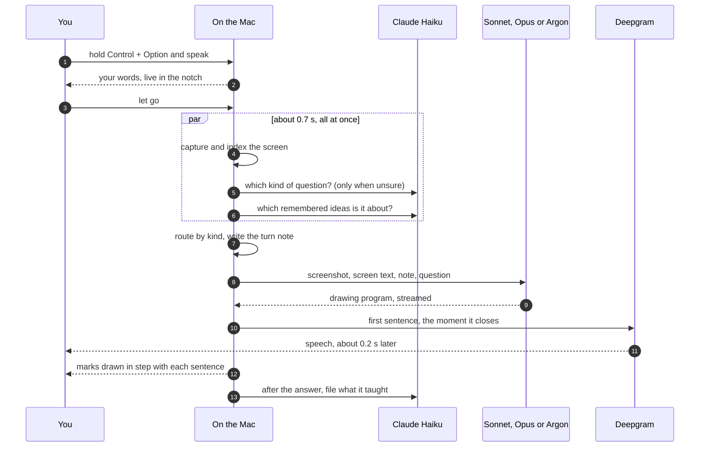
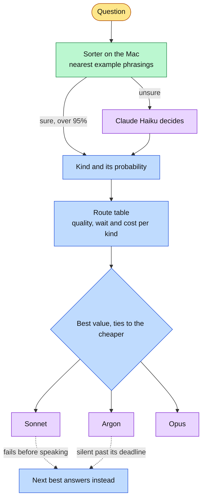
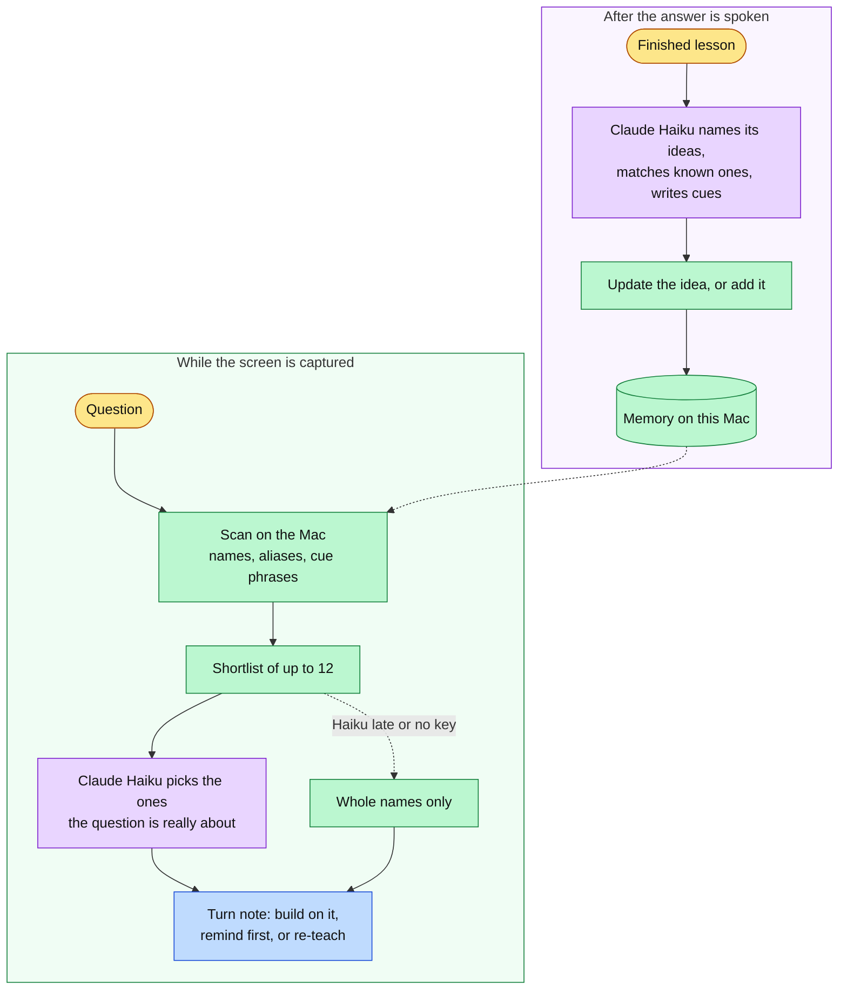
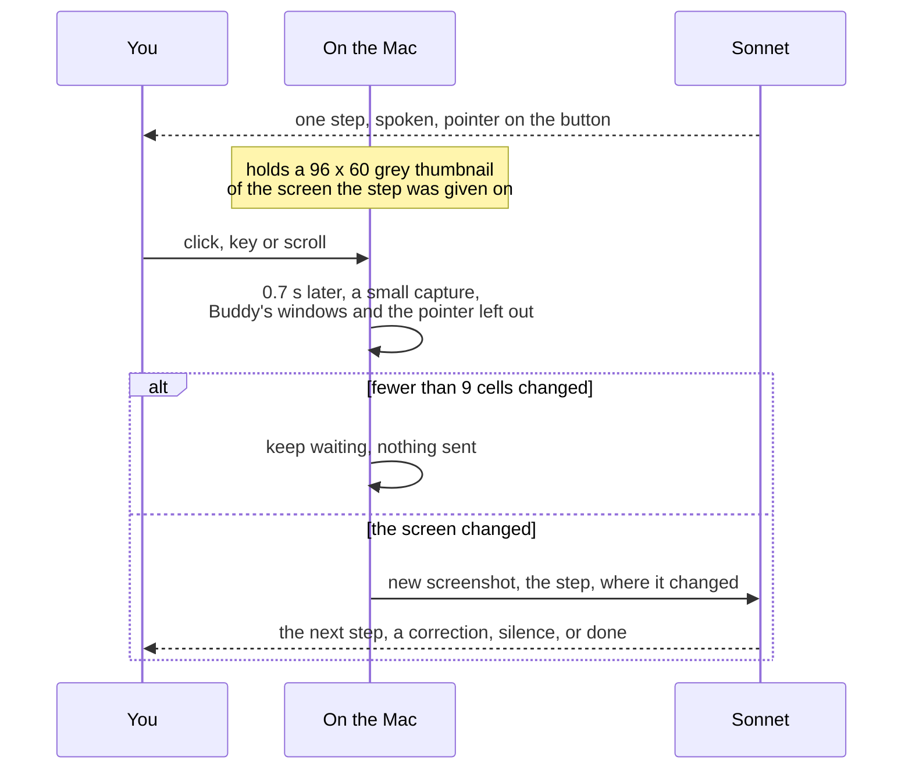

# How Buddy works

What happens between asking and hearing the first sentence, and how each feature stays out of that wait.

## One question, start to finish

Everything that is not the answer itself either runs during the screen capture, which has to happen anyway, or after the answer is spoken. The only wait is the model's first sentence.

A typed question (Control + Option + T, or the chat box) joins at step 4: it skips speech, and everything after is the same. The chat box lives in the notch, which is a non-activating panel, so typing in it never takes the front away from the app being studied; the screen read and the app named in the turn note are still that app's.

## The answer is a program

The model does not answer in prose. It writes a small JavaScript program in beats: `say("...")` for a spoken sentence, then the marks drawn while it is said, such as `ring("t35")` around a line of code on the real screen, or `paper(...)` for a hand-drawn card on calm space. The program streams, so the first sentence is spoken while the rest is still being written, and each sentence's strokes are paced across its audio.

Screen marks name things by id from the screen index, a numbered list of every piece of text on screen with its exact box, built from Apple Vision and the accessibility tree. That is what lets "the third line" land on the third line.

## Choosing the model

The route table comes from racing all three models on every kind of question and having two judges from different model families score the answers blind. The race, the judging and the sensitivity of the choice to how much waiting is worth are in [model-choice.md](model-choice.md).

## Learning memory

Three problems come with memory that grows forever and is read while someone waits.

- **Speed.** The hard part, understanding what an idea is and how a student might describe it without its name, happens once, at filing time: Haiku writes the plain-words cues ("charged twice" for an idempotency key) and likely mishearings ("item potent"). Reading is then a single in-memory scan, about 5 ms over 5,000 ideas, plus a Haiku choice that runs inside the capture.
- **Growth.** A new explanation updates the idea it is about instead of adding another copy, so the store grows with ideas, not questions. Ideas met once and unseen for four months move to an archive and return, history intact, when they come up again.
- **Staleness.** Each idea keeps only its latest explanation. How well it is probably remembered follows the FSRS forgetting curve, which decides whether the tutor builds on it, gives a one-line reminder, or teaches it again. Vectors are tagged with the sentence model that made them and re-made in the background if a macOS update changes it.

Measured on 80 questions written by someone who never saw the code: on the held-out half the cascade found 32 of 33 relevant ideas at 88 to 91% precision across repeated runs and left 9 of 10 unrelated questions alone. The tests are in `scripts/learning_memory/`.

## Hints and diagram review

Both are notes added to the turn, never to the cached system prompt, so the prompt cache holds.

- **Practice problems** are recognised by the window (LeetCode, HackerRank and others) or by a page with an example, constraints and a submit button. What was said decides the rung asked for, the program reports the rung it gave with `hintLevel(n)`, and the rung is kept per problem for two days.
- **Diagrams** are recognised by the drawing tool in front, or by the student saying it is their own design. The tutor marks their boxes by id and proposes additions with `suggest(...)`, drawn dashed and purple beside them.

Both were checked on Sonnet and Argon with drawn screens: 32 of 32 checks passed (`scripts/study_modes/`).

## Guide mode

When the question is a task in an app ("how do I export this"), the answer gives only the first step and ends with `waitForStep("click Export as PDF", "a save dialog")`. There is no switch: the model decides from the question, and a question that is not a task never starts one.

The watching costs no tokens: nothing is captured without input from the student, and the comparison is a few thousand subtractions on the Mac. The model is asked again only when the screen visibly changed, which is one ordinary answer, about a cent with Sonnet. The note tells it where the change was, so a menu that just opened is read as the step done. Switching to an app the step does not name is not counted, the menu bar clock is ignored, and a guide ends on Esc, Stop, a new question, 15 steps or 5 minutes without progress. Guide steps are not filed into learning memory; "click Export" is not an idea.

Menu bar titles and an open menu's items are kept in the screen index, which otherwise drops everything outside the front window as chrome, so a step can point at File and then at Export as PDF by id.

## Where things live

| What | Where |
|---|---|
| Keys | macOS Keychain, saved and read through `/usr/bin/security` so updates never prompt |
| Transcripts | `~/Library/Application Support/ClickyLocal/Transcripts`, one Markdown file a day |
| Memory and hint steps | `~/Library/Application Support/ClickyLocal/Memory` |
| Log | `~/Library/Logs/ClickyLocal.log` |
