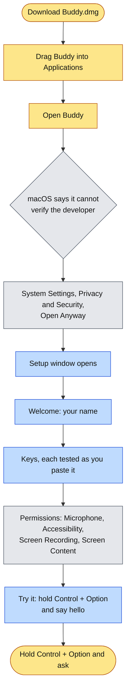
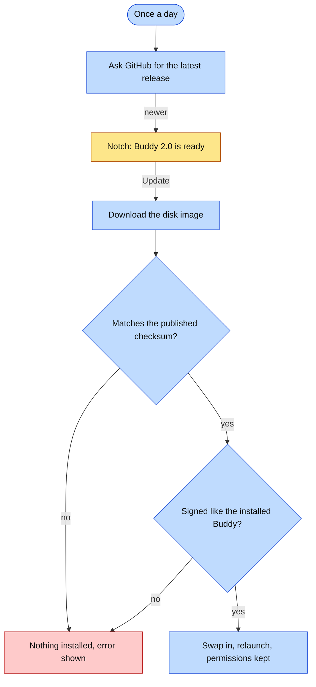

# Installing Buddy

About five minutes, most of it making API keys. Buddy runs on any Mac with Apple silicon or Intel and macOS 14.2 or later.



Yellow is you, grey is macOS, blue is Buddy's own setup.

## 1. Download and install

1. **[Download Buddy for Mac](https://github.com/projects-hacks/buddy/releases/latest/download/Buddy.dmg)**. This link always gets the newest version.
2. Open it and drag **Buddy** onto **Applications**. The window that opens shows all three steps as pictures.
3. Eject the disk image.

**Or with Homebrew**, in Terminal:

```bash
brew tap projects-hacks/buddy https://github.com/projects-hacks/buddy
brew trust projects-hacks/buddy
brew install --cask projects-hacks/buddy/buddy
```

Homebrew adds Buddy's repository as a tap, then asks you to trust it before installing from it. Buddy updates itself afterwards, so `brew upgrade` is not needed.

## 2. Open it the first time

Buddy is signed, but not notarized by Apple, so macOS asks once before opening it.

1. Open **Buddy** from Applications. macOS says it could not verify it; click **Done**.
2. Open **System Settings > Privacy & Security**, scroll to the message about Buddy, and click **Open Anyway**.
3. Confirm with your password or Touch ID. From then on it opens normally, including after updates.

The same thing from Terminal, if preferred:

```bash
xattr -dr com.apple.quarantine /Applications/Buddy.app
```

## 3. Setup

The setup window opens by itself and has four steps, Welcome, Keys, Permissions and Try it, with a dot for each at the top.

**Welcome.** What Buddy does, and your first name, used in the greeting and so Buddy can address you.

**Keys.** Buddy uses your own accounts, so you pay only for what you use. Each key is tested the moment you paste it; if something is wrong you are told what, and can paste again. Keys are stored in this Mac's Keychain and sent only to the service they belong to.

| Key | Needed? | What it adds | Where to get it |
|---|---|---|---|
| Anthropic | Recommended | Claude Sonnet and Opus answer; Claude Haiku sorts questions and keeps learning memory | [console.anthropic.com](https://console.anthropic.com/settings/keys) |
| Google Gemini | Optional | Gemini 4 Argon, which answers most explanations under Auto | [aistudio.google.com](https://aistudio.google.com/apikey) |
| Deepgram | Optional | A natural voice, and hearing that gets technical words and long pauses right; without it macOS's own voice and recognizer are used | [console.deepgram.com](https://console.deepgram.com/) |

At least one of Anthropic or Gemini is needed to continue. With both, Auto picks the best model per question.

<details>
<summary>Making an Anthropic key</summary>

1. Sign in at [console.anthropic.com](https://console.anthropic.com/).
2. Add credit under **Plans & Billing**. A few dollars lasts a long time: a question costs about one to six cents.
3. Open **API Keys**, click **Create Key**, and copy it. It starts with `sk-ant-`.
</details>

<details>
<summary>Making a Gemini key</summary>

1. Sign in at [aistudio.google.com/apikey](https://aistudio.google.com/apikey) with a Google account.
2. Click **Create API key** and copy it. It starts with `AIza`.
3. If Buddy says the key cannot use Gemini 4 Argon, turn on billing for the key's Google Cloud project.

People already set up with the Google Cloud CLI can choose **Google Cloud** instead of **An API key** in the Gemini card and give a project ID; Argon then bills that project through Vertex, and no key is stored.
</details>

<details>
<summary>Making a Deepgram key</summary>

1. Sign up at [console.deepgram.com](https://console.deepgram.com/).
2. Open **API Keys**, create a key with the **Member** role, and copy it.
</details>

**Permissions.** Each one says why it is needed, and a bar shows how many are allowed. **Skip for now** moves on without them; the closed notch then says in amber which one is missing.

| Permission | Why |
|---|---|
| Microphone | Hears your question while you hold Control + Option. Also listens while an answer plays, so you can talk over it, and hands free while you teach a topic back. It is not open at any other time. |
| Accessibility | Notices Buddy's shortcuts from any app (Control + Option, Control + Option + T), and finds the button to point at |
| Screen Recording | Sees what you are asking about, only when you ask (by voice or typing) or while Buddy guides you through a task. macOS asks you to reopen Buddy after this one. |
| Screen Content | Reads the text on screen so marks land exactly; offered by macOS once Screen Recording is on |

Two more are asked later, only when first needed. Buddy works without either.

| Permission | Asked | Why |
|---|---|---|
| System Audio Recording | At the first question about a video where its sound would help | Hears only the sound of the video in front, never the microphone or a call, so Buddy knows what the lecturer just said. The last 90 seconds are kept in memory, never on disk. |
| Notifications | At the first PDF export from the Notebook | Says the PDF is ready, with Open PDF. If refused, the notch shows the result instead. |

**Try it.** Hold Control + Option and say hello. The keys light up while held and your words appear. "Buddy heard you. The microphone and the shortcut both work." means everything is set. The trial is heard by the Mac's own recognizer and nothing is sent anywhere; it can be skipped. The same step has a switch for **Open Buddy when you log in**, and **Start using Buddy** closes setup, leaving Buddy in the notch.

## Updating

From 1.2 on, Buddy keeps itself current. Once a day it checks for a newer release, and when there is one the open notch says **Buddy 2.0 is ready** with **What's new** and **Update**. Update downloads it, checks it against the checksum published with the release, checks it is signed by the same certificate as the copy you have, swaps it in and relaunches. Keys, memory, the Notebook and permissions carry over, and there is no Open Anyway this time, because Buddy downloaded it rather than a browser. Settings has **Check now**; the daily check is always on.



On 1.0 or 1.1, which have no updater, install the newest release by hand once, the same way as the first time (download, drag into Applications, replace). Everything after that arrives on its own.

## Changing keys later

Hover the notch, open the gear tab, and choose **Name and keys**. If a key stops working while you use Buddy, it says so out loud and opens this window on the key that failed.

## Troubleshooting

| What happens | What to do |
|---|---|
| "didn't accept this key" | Copy the key again in full, or make a new one. |
| "has no credit" | Add credit to that account. The key itself is fine. |
| "looks like a Google key" | It was pasted into the wrong field. |
| "Couldn't reach" | Check the internet connection and press Test and save again, or Save anyway. |
| Holding Control + Option does nothing | Accessibility is not allowed yet. The closed notch says so in amber; open it and click **Allow**, which opens setup on Permissions. If Buddy is missing from the list in System Settings, click "Buddy not in the list?" and drag Buddy in from the Finder window it opens. |
| Control + Option + T does nothing | Also Accessibility. Allow it as above. |
| Try it says "The shortcut isn't reaching Buddy" | Accessibility, as above. |
| Try it says "Nothing heard" | The microphone is not allowed, or another input is selected. The button beside it opens the Microphone settings. Try it can also be skipped. |
| Talking over an answer does nothing | Buddy listens over an answer only while it is speaking, and never through a Bluetooth headset, whose microphone would make the whole answer sound like a phone call. Use the Mac's microphone, or hold Control + Option to ask. |
| Buddy does not notice a step was done | It looks after a click, key or scroll, once the screen has changed. If it still waits, ask "what next?" yourself. |
| Buddy answers about the wrong thing on screen | Screen Recording or Screen Content is not allowed. Allow both, then reopen Buddy. |
| A question about a video ignores what was said | Buddy reads the video's transcript first and uses its sound only as a fallback. If System Audio Recording was refused, allow Buddy in System Settings > Privacy & Security > Screen & System Audio Recording. Calls, meetings, music apps, adverts and protected video are never heard. |
| No notification after a PDF export | Notifications were refused, so the notch shows the result instead. To get them, allow Buddy in System Settings > Notifications. |
| The voice sounds robotic | No Deepgram key, so macOS's own voice is reading. Add one in setup. |
| No notch on this Mac | Buddy hangs from the middle of the menu bar instead; everything else is the same. |

The log at `~/Library/Logs/Buddy.log` records every step of every question, which helps when asking for help. The previous session's log is kept beside it as `Buddy.previous.log`.

## Removing Buddy

Turn off **Open at login** in the notch's gear tab, quit Buddy from there, and delete it from Applications. If wanted, also remove what it kept on this Mac:

```bash
# memory and the map's links, how-tos, hint steps, the Notebook, transcripts, spending
rm -rf ~/Library/Application\ Support/Buddy
# logs and settings
rm -f ~/Library/Logs/Buddy.log ~/Library/Logs/Buddy.previous.log ~/Library/Logs/Buddy.rotated.log
defaults delete com.maverickrajeev.clicky-local
# keys
security delete-generic-password -a api-key -s com.maverickrajeev.clicky-local.anthropic
security delete-generic-password -a api-key -s com.maverickrajeev.clicky-local.gemini
security delete-generic-password -a api-key -s com.maverickrajeev.clicky-local.deepgram
# its entries in Privacy & Security
tccutil reset All com.maverickrajeev.clicky-local
```

PDFs exported from the Notebook stay wherever they were saved. Installed with Homebrew, `brew uninstall --zap --cask projects-hacks/buddy/buddy` also removes the data folder, the current and previous logs and the settings, but not the keys.
