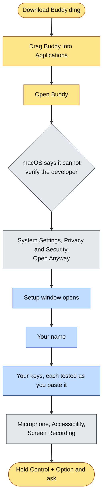

# Installing Buddy

About five minutes, most of it making API keys. Buddy runs on a Mac with Apple silicon and macOS 14.2 or later.



Yellow is you, grey is macOS, blue is Buddy's own setup.

## 1. Download and install

1. **[Download Buddy for Mac](https://github.com/projects-hacks/buddy/releases/latest/download/Buddy.dmg)**. This link always gets the newest version.
2. Open it and drag **Buddy** onto **Applications**.
3. Eject the disk image.

## 2. Open it the first time

Buddy is signed, but not notarized by Apple, so macOS asks once before opening it.

1. Open **Buddy** from Applications. macOS says it could not verify it; click **Done**.
2. Open **System Settings > Privacy & Security**, scroll to the message about Buddy, and click **Open Anyway**.
3. Confirm with your password or Touch ID. From then on it opens normally, including after updates.

The same thing from Terminal, if preferred:

```bash
xattr -dr com.apple.quarantine /Applications/Buddy.app
```

## 3. Setup

The setup window opens by itself and has four steps.

**Your name.** Used in the greeting and so Buddy can address you.

**Your keys.** Buddy uses your own accounts, so you pay only for what you use. Each key is tested the moment you paste it; if something is wrong you are told what, and can paste again. Keys are stored in this Mac's Keychain and sent only to the service they belong to.

| Key | Needed? | What it adds | Where to get it |
|---|---|---|---|
| Anthropic | Recommended | Claude Sonnet and Opus answer; Claude Haiku sorts questions and keeps learning memory | [console.anthropic.com](https://console.anthropic.com/settings/keys) |
| Google Gemini | Optional | Gemini 4 Argon, which answers most explanations under Auto | [aistudio.google.com](https://aistudio.google.com/apikey) |
| Deepgram | Optional | A natural voice; without it macOS's own voice speaks | [console.deepgram.com](https://console.deepgram.com/) |

At least one of Anthropic or Gemini is needed. With both, Auto picks the best model per question.

<details>
<summary>Making an Anthropic key</summary>

1. Sign in at [console.anthropic.com](https://console.anthropic.com/).
2. Add credit under **Plans & Billing**. A few dollars lasts a long time: a question costs about one to six cents.
3. Open **API Keys**, click **Create Key**, and copy it. It starts with `sk-ant-`.
</details>

<details>
<summary>Making a Gemini key</summary>

1. Sign in at [aistudio.google.com/apikey](https://aistudio.google.com/apikey) with a Google account.
2. Click **Create API key** and copy it. It starts with `AIza`.
3. If Buddy says the key cannot use Gemini 4 Argon, turn on billing for the key's Google Cloud project.

People already set up with the Google Cloud CLI can choose **Google Cloud** instead of **An API key** in the Gemini card and give a project ID; Argon then bills that project through Vertex, and no key is stored.
</details>

<details>
<summary>Making a Deepgram key</summary>

1. Sign up at [console.deepgram.com](https://console.deepgram.com/).
2. Open **API Keys**, create a key with the **Member** role, and copy it.
</details>

**Permissions.** Each one says why it is needed, and the next one to allow is highlighted.

| Permission | Why |
|---|---|
| Microphone | Hears your question while you hold Control + Option |
| Accessibility | Notices Control + Option and Control + Option + T from any app, and finds the exact button to point at |
| Screen Recording | Sees what you are asking about, only when you ask (by voice or typing) or while Buddy guides you through a task. macOS asks you to reopen Buddy after this one. |
| Screen Content | Reads the text on screen so marks land exactly; offered by macOS once Screen Recording is on |

**Done.** A short how-to, then Buddy waits in the notch.

## Updating

From 1.2 on, Buddy keeps itself current. Once a day it checks for a newer release, and when there is one the open notch says **Buddy 1.3 is ready** with **What's new** and **Update**. Update downloads it, checks it against the checksum published with the release, checks it is signed by the same certificate as the copy you have, swaps it in and relaunches. Keys, memory and permissions carry over, and there is no Open Anyway this time, because Buddy downloaded it rather than a browser. Settings has **Check now** and a switch to stop the daily check.


On 1.0 or 1.1, which have no updater, install 1.2 by hand once, the same way as the first time (download, drag into Applications, replace). Everything after that arrives on its own.

## Changing keys later

Hover the notch, open the gear tab, and choose **Name and API keys**. If a key stops working while you use Buddy, it says so out loud and opens this window on the key that failed.

## Troubleshooting

| What happens | What to do |
|---|---|
| "didn't accept this key" | Copy the key again in full, or make a new one. |
| "has no credit" | Add credit to that account. The key itself is fine. |
| "looks like a Google key" | It was pasted into the wrong field. |
| "Couldn't reach" | Check the internet connection and press Test and save again, or Save anyway. |
| Holding Control + Option does nothing | Accessibility is not allowed yet. In the notch's gear tab, click Allow next to it. If Buddy is missing from the list, use "Show it in Finder" and drag Buddy in. |
| Control + Option + T does nothing | Also Accessibility. Allow it as above. |
| Buddy does not notice a step was done | It looks after a click, key or scroll, once the screen has changed. If it still waits, ask "what next?" yourself. |
| Buddy answers about the wrong thing on screen | Screen Recording or Screen Content is not allowed. Allow both, then reopen Buddy. |
| The voice sounds robotic | No Deepgram key, so macOS's own voice is reading. Add one in setup. |
| No notch on this Mac | Buddy hangs from the middle of the menu bar instead; everything else is the same. |

The log at `~/Library/Logs/Buddy.log` records every step of every question, which helps when asking for help.

## Removing Buddy

Quit it from the notch's gear tab, delete it from Applications, and if wanted remove its data and keys:

```bash
rm -rf ~/Library/Application\ Support/Buddy
security delete-generic-password -a api-key -s com.maverickrajeev.clicky-local.anthropic
security delete-generic-password -a api-key -s com.maverickrajeev.clicky-local.gemini
security delete-generic-password -a api-key -s com.maverickrajeev.clicky-local.deepgram
```
