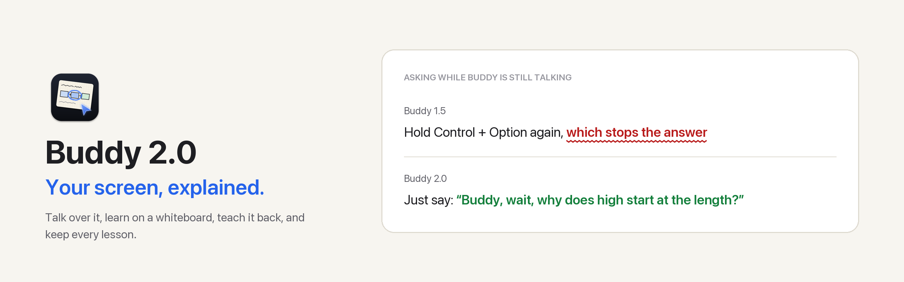
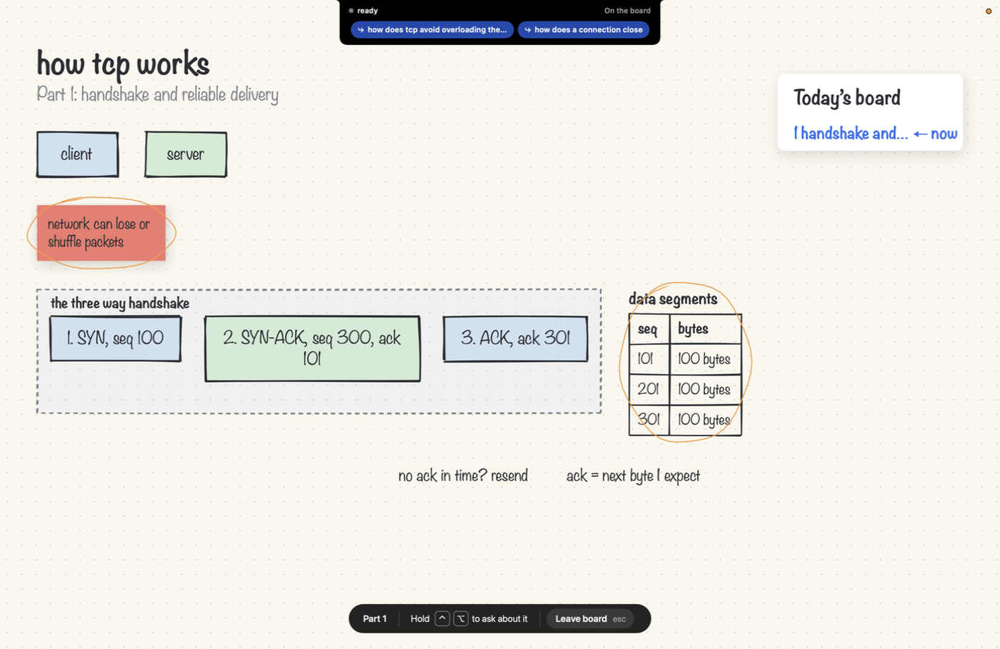
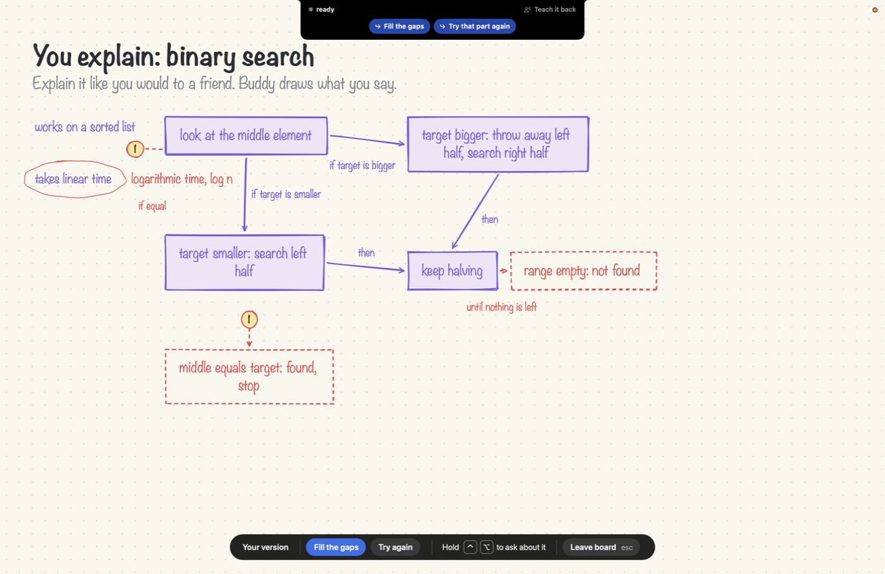
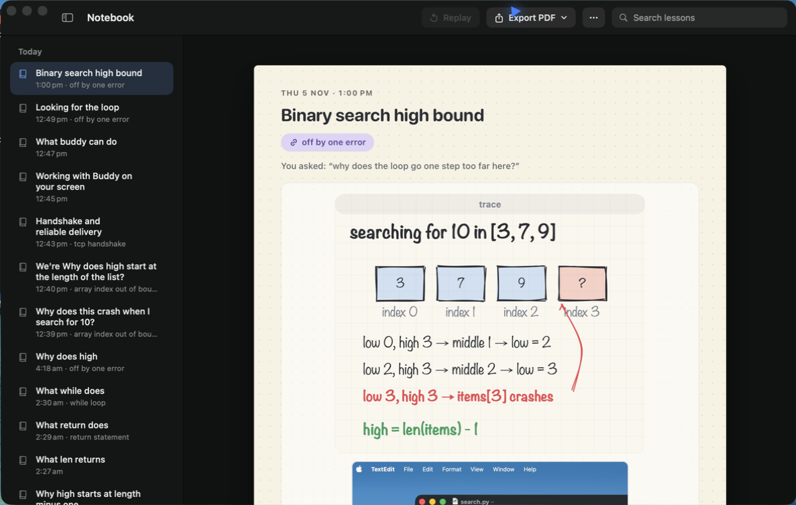
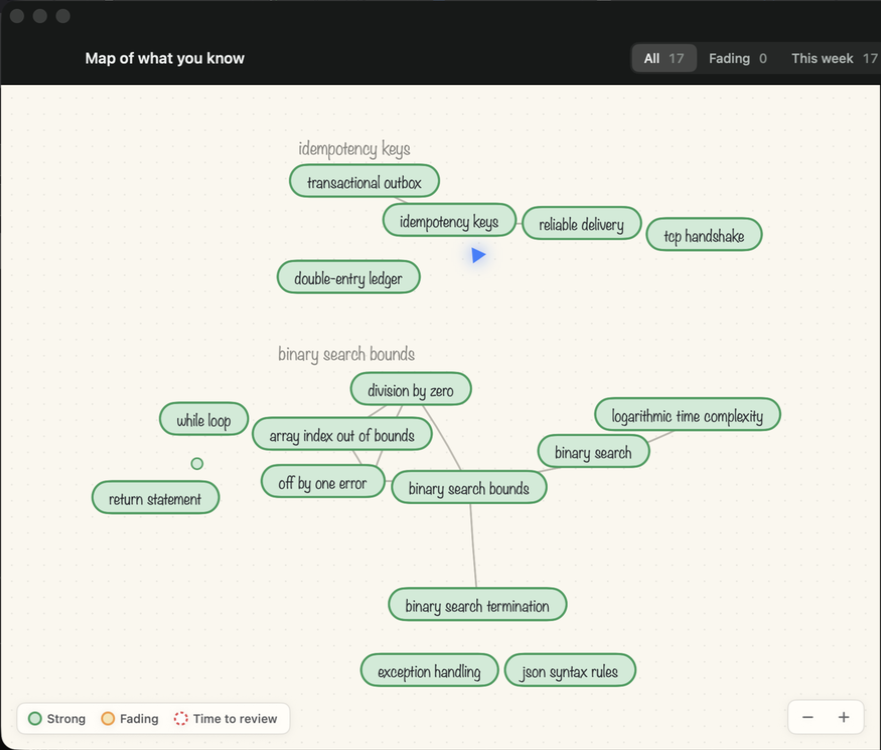
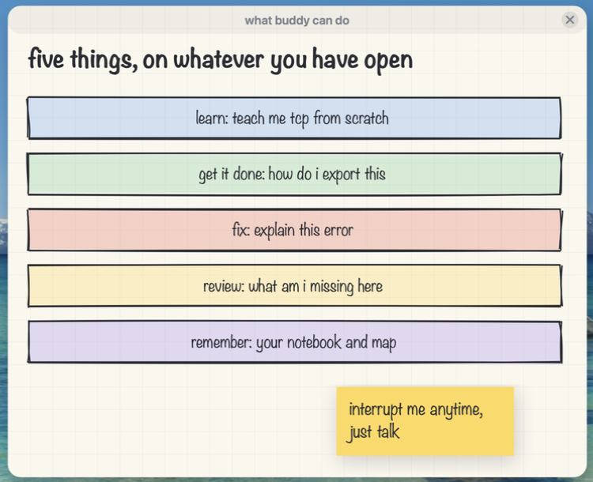

<picture>
  <source media="(prefers-color-scheme: dark)" srcset="https://raw.githubusercontent.com/projects-hacks/buddy/main/docs/images/whats-new/2.0/banner-dark.png">
  
</picture>

<p align="center">
  <a href="https://github.com/projects-hacks/buddy/releases/latest/download/Buddy.dmg"></a>
</p>

<p align="center">
  
  
  
  
</p>

<p align="center"><b>Ask about anything on your screen. Buddy explains it out loud and draws on it while it talks.</b><br>
2.0 is the biggest release yet: learn, get things done, fix errors, review your work, and remember all of it.</p>

> [!TIP]
> **New in 2.0.2: Buddy follows the lecture as it plays.** While a video plays in front, Buddy turns its sound into words on your Mac, so "what did he just say?" is answered at once and nothing is sent anywhere for it. It files the words by the video's time, so asking after a pause, a rewind or a look at another app gets the minute before where you are. The lecturer on your speakers is no longer taken for you, whether Buddy is talking or you are holding the keys. And to cut in while Buddy talks, you now say its name first, "Buddy, wait…", so talking to a friend no longer stops it. And the first question after Buddy starts is now sized properly: it used to be guessed before Haiku could answer.
>
> **2.0.1: small talk is just small talk.** Say "thanks, that's helpful" and Buddy says something like "Anytime, Rajeev, glad it helped." and leaves it there: no drawing, no notebook page. Questions are also sized more accurately: 94 or 95 of 100 blind study questions over three runs, up from 90.

Everything below is what 2.0 brought, for anyone updating from 1.5 or earlier.

##  Talk over it

While Buddy explains, say its name and speak. No keys, nothing to switch on. Without the name it keeps going, so a friend in the room or a video playing never interrupts it.

| Say | Buddy |
|:--|:--|
| "Buddy, wait, why does high start at the length?" | Stops and answers your question |
| "Buddy, hold on" | Pauses mid-sentence |
| "Go on" | Carries on from where it stopped |
| "Buddy, slower" | Slows the rest of the answer |
| "Buddy, go back" | Says the last sentence again |
| "Buddy, say that again" | Replays the whole answer, free |

> [!NOTE]
> The microphone is open only while an answer plays, and the notch shows a mic whenever it is. Esc or Stop closes it. Buddy's own voice is filtered out, so it never cuts itself off.

##  Learn anything from scratch

Say **"teach me TCP from scratch"** and the screen turns into a whiteboard. Buddy teaches it part by part, over as many questions as you like.

<p align="center"></p>

##  Teach it back

Say **"let me explain binary search back to you"** and explain it out loud. Buddy draws what you said in purple, exactly as you said it, then marks the gaps in red.

<p align="center"></p>

| You said | Buddy marked |
|:--|:--|
| "You keep halving, so it takes linear time" | Ringed, with **logarithmic time, log n** beside it |
| Nothing about when it stops | **Middle equals target: found, stop** and **range empty: not found**, dashed |

What you got right counts as remembered; what you missed comes back sooner on the map.

##  Explain the error you just hit

When an error appears in a terminal or editor, a soft red glow shows under the notch. Tap Control + Option, or hover and pick **Explain this error**, and Buddy rings the line that caused it. Nothing is sent anywhere until you ask, and the same error is never offered twice.

| On errors written after the recognizer was built | |
|:--|:--|
| Errors recognized | **20 of 20** |
| False alarms on output that only looks like an error | **0 of 18** |
| Rings the right file and line | **17 of 17** |

##  Knows what the lecture said

Watching a video lecture? Ask "what did she mean by that?" and Buddy knows the last minute of what was said, from the page's transcript, or from the video's own sound once you allow it. Never your microphone, never calls or meetings, kept in memory only.

##  A notebook that writes itself

Every lesson becomes a page: its drawing, a sharp picture of what it marked on your screen, what Buddy said, and links to teach it back. Search it, and export a day, a range or everything as a PDF in the background.

<p align="center"></p>

##  A map of what you know

Every idea Buddy has taught you, joined to related ideas, coloured by how well you still remember it: **Strong**, **Fading**, or **Time to review**. Click one for a quick recap or to teach it back.

<p align="center"></p>

##  Answers the size of your question

| You said | Before 2.0 | Now |
|:--|:--|:--|
| "hello buddy" | Started describing your screen and ringing things | "Hey Rajeev, good to see you." |
| "what's the time complexity of binary search?" | Sized as a long answer | Two sentences, one ring on the line that halves |
| "what all can you do?" | A vague list | A card of all five areas, each with one thing to try |

<p align="center"></p>

##  A new look

The notch, Settings and setup are rebuilt. Settings is eight controls with nothing to scroll. Hover **Spent today** to see what Claude, Gemini and Deepgram each cost, and what for. Setup ends by checking your shortcut and microphone for real. **How to use Buddy** now opens [the guide](https://projects-hacks.github.io/buddy/guide/).

##  Also in this release

| Area | What changed |
|:--|:--|
| **First word sooner** | The screen is read while you are still talking |
| **Point at what you mean** | Select text, or rest the pointer on a line while you hold the keys, and that is what "this" means |
| **Marks follow** | Rings stay on their line when you scroll, move or resize the window |
| **Draws only when it helps** | Short answers no longer come with a card |
| **Replay** | Plays the last answer again, voice and drawing, at no cost |
| **Steadier** | Recovers from sleep, a changed microphone or speaker, and a slow model; a stalling model is set aside for longer each time it keeps failing |
| **Fixed** | A crash when an error offer appeared; a crash on an answer of only drawing tags; a lesson could overwrite an unrelated idea in memory |

##  Updating

| You have | Do this |
|:--|:--|
| Buddy 1.2 or later | Click **Update** when the notch offers it |
| Buddy 1.0 or 1.1 | Download, drag onto Applications, choose **Replace** |
| Homebrew | `brew upgrade --cask projects-hacks/buddy/buddy` |

> [!NOTE]
> Your keys, memory and permissions stay as they are. Two permissions are asked only when first needed: System Audio Recording for a lecture with no transcript, and Notifications for your first PDF export.

<details>
<summary> <b>First time installing?</b></summary>
<br>
<p align="center"></p>

Or with Homebrew:

```bash
brew tap projects-hacks/buddy https://github.com/projects-hacks/buddy
brew trust projects-hacks/buddy
brew install --cask projects-hacks/buddy/buddy
```

More help: [install guide](https://github.com/projects-hacks/buddy/blob/main/docs/install.md) and [how to use Buddy](https://projects-hacks.github.io/buddy/guide/).
</details>

<sub> Every update is checked against <code>Buddy.dmg.sha256</code> and the app's signature before it installs. To check a download by hand: <code>shasum -a 256 -c Buddy.dmg.sha256</code></sub>
