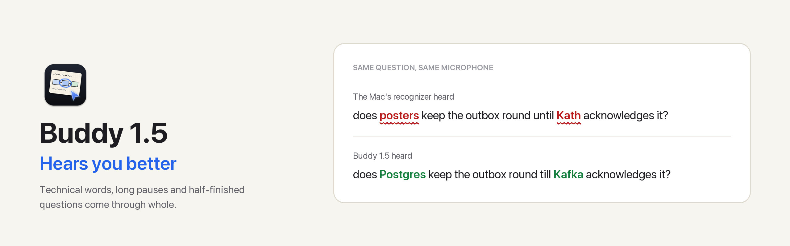
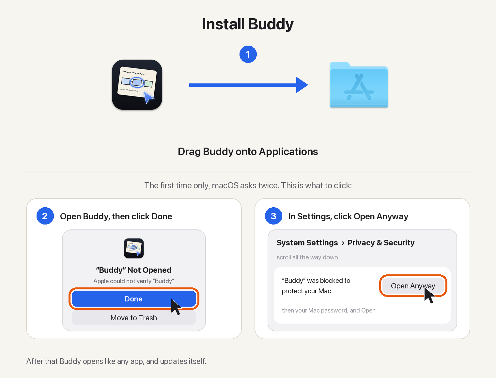

<picture>
  <source media="(prefers-color-scheme: dark)" srcset="https://raw.githubusercontent.com/projects-hacks/buddy/main/docs/images/whats-new/1.5/banner-dark.png">
  
</picture>

<p align="center">
  <a href="https://github.com/projects-hacks/buddy/releases/latest/download/Buddy.dmg"></a>
</p>

<p align="center">
  
  
  
  
</p>

##  Gets technical words right

With a Deepgram key, Deepgram now hears your questions as well as speaking the answers. The same questions, on the same microphone:

| You said | The Mac's recognizer heard | Buddy 1.5 hears |
|:--|:--|:--|
| Kafka | ~~Kakkar~~ | **Kafka** |
| idempotent | ~~Eden potent~~ | **idempotent** |
| Postgres | ~~posters~~ | **Postgres** |

Before you speak, Buddy tells it which words to expect: the labels on your screen, the terms on cards it just drew, and the ideas you have been learning. About a third of a cent per question, shown in **Spent today**.

> [!TIP]
> No Deepgram key? Nothing changes: the Mac's own recognizer hears you as before. With a key, it still listens alongside, in case the connection drops.

##  Take your time

| | Before | Now |
|:--|:--|:--|
| Pause to think mid-question | Only the words after the pause arrived | **The whole question arrives** |
| Let go too early, press again | Two separate questions | **Joined into one**, if the answer has not started |

##  Long sessions stay in view

| | Before | Now |
|:--|:--|:--|
| Questions kept in view | 10 | **40** |
| Older answers | Forgotten | **What was said is kept** |

Recent answers are kept with their drawings; older ones keep what was said, so long sessions stay cheap.

##  Also in this release

| Area | What changed |
|:--|:--|
| **Fixed** | Buddy could stop responding when the microphone changed, for example AirPods connecting. It now keeps listening. |
| **Spent today** | Counts answers you cut off, and keeps the last cents of the day when Buddy quits. |
| **Mishearings** | When a word is still misheard, Buddy answers what you meant. |
| **Chat** | Long folded answers no longer draw over the messages below. |

##  Updating

| You have | Do this |
|:--|:--|
| Buddy 1.2 or later | Click **Update** when the notch offers it |
| Buddy 1.0 or 1.1 | Download, drag onto Applications, choose **Replace** |
| Homebrew | `brew upgrade --cask projects-hacks/buddy/buddy` |

> [!NOTE]
> Your keys, memory and permissions stay as they are.

<details>
<summary> <b>First time installing?</b></summary>
<br>
<p align="center"></p>

Or with Homebrew:

```bash
brew tap projects-hacks/buddy https://github.com/projects-hacks/buddy
brew trust projects-hacks/buddy
brew install --cask projects-hacks/buddy/buddy
```

More help: [install guide](https://github.com/projects-hacks/buddy/blob/main/docs/install.md).
</details>

<sub> Every update is checked against <code>Buddy.dmg.sha256</code> and the app's signature before it installs. To check a download by hand: <code>shasum -a 256 -c Buddy.dmg.sha256</code></sub>
