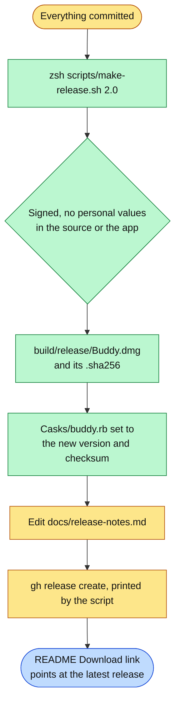

# Making a release

For the repository's owner. A release is a disk image on GitHub Releases that anyone can download.

1. Commit everything. The script refuses to run with any uncommitted change, since a release should be exactly a commit, and stops if the `Clicky Local Dev` certificate is not in the Keychain.
2. Run `zsh scripts/make-release.sh 2.0` with the new version. With no version it uses the project's `MARKETING_VERSION`; the build number is the commit count. Before building, it searches the app's source for personal values of whoever is releasing (the Google Cloud project in Buddy's defaults on this Mac, the name part of the git email, a `/Users/<name>` path) and stops if one is there. It builds the Release configuration for Apple silicon and Intel into its own folder outside the home folder, so the copy in daily use is untouched and no home path is compiled in. It signs it with the same certificate as every earlier release, checks the built app for the same personal values, lays out the disk image window, writes `build/release/Buddy.dmg` and its checksum, and sets `version` and `sha256` in `Casks/buddy.rb` to the new image.
3. Update `docs/release-notes.md` in the layout under Release notes below, render it and look at it.
4. Run the `gh release create` command the script prints. It attaches `Buddy.dmg` and `Buddy.dmg.sha256`, which the updater relies on, and uses `docs/release-notes.md` as the notes. Every copy from 1.2 on finds it within a day and offers it in the notch. The file name never changes, so the README's Download button, which points at the latest release's `Buddy.dmg`, always gets the newest one.

5. Commit `Casks/buddy.rb`, the Homebrew cask in this repository, once the release is published, since Homebrew downloads from the release. Copies installed with Homebrew update themselves either way; this keeps fresh `brew install`s on the newest version.

**Release notes.** `docs/release-notes.md` is the release page people read before deciding to download, so it is laid out to be scanned, not read:

- A banner on top, in a light and a dark version shown with `<picture>`, drawn by `scripts/release-art/make_release_art.py` (set the version, headline and the real before and after in its `BANNER` first). Then the Download button and a row of badges.
- One section per headline change, its heading led by an icon from `docs/images/icons/` (drawn by the same script), and the section led by something visual: a before and after table, a screenshot or a short GIF. Numbers in them come from real runs, never estimates.
- GitHub's callouts (`> [!TIP]`, `> [!NOTE]`) for the one thing a reader must not miss in a section, at most one per section.
- Everything smaller in one table, `Area | What changed`, one line each.
- An Updating table (1.2 or later, 1.0 or 1.1, Homebrew) and a collapsed First time installing section with the install picture.
- Plain words for someone who has never seen the code: what changed for them, not how it was built. No internal test numbers, no em or en dashes.
- Before publishing, render it the way GitHub will (`gh api markdown` with `mode: gfm`) and look at it: no empty table headers, no broken images, nothing that only makes sense to a developer.

**Why the same certificate every time.** macOS ties Microphone, Screen Recording and Accessibility to the app's signature. A release signed with the same certificate keeps everyone's permissions; a new certificate would make everyone grant them again. Keep the certificate backed up: Keychain Access, right-click it, Export.

**The disk image window.** It shows the install steps as its background, drawn by `scripts/dmg/make_background.py` (rerun it after changing the steps), showing what macOS shows the first time and the button to press in each. Finder lays the window out when the release script asks it to; the first time, macOS asks to let the terminal control Finder. If that is refused the image is still made, with Finder's plain layout, and the script says so.

**Why not notarized.** Notarization needs a paid Apple Developer account. Without it macOS asks once, the first time Buddy is opened, which the disk image window and [install.md](install.md) walk through. With an account, signing with a Developer ID certificate and running `xcrun notarytool submit` on the disk image removes that step. Switching is a one-time move, not a setting: copies already installed accept only updates signed by the certificate they were signed with, so the first notarized release has to be downloaded by hand once, and every update after it arrives by itself again.
