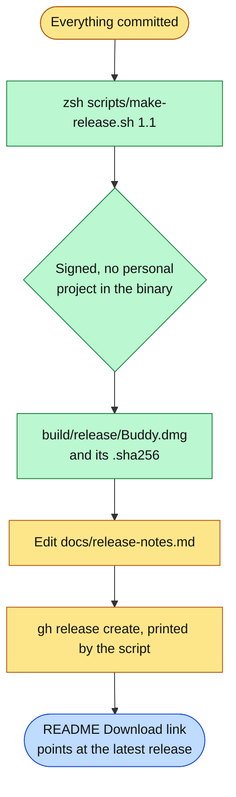

# Making a release

For the repository's owner. A release is a disk image on GitHub Releases that anyone can download.

1. Commit everything. The script refuses to package uncommitted app code.
2. Run `zsh scripts/make-release.sh 1.1` with the new version. It builds the Release configuration into its own folder, so the copy in daily use is untouched, signs it with the same `Clicky Local Dev` certificate as every earlier release, stops if a personal Google Cloud project is still in the binary, and writes the disk image and its checksum.
3. Update `docs/release-notes.md`.
4. Run the `gh release create` command the script prints. Every copy from 1.2 on finds it within a day and offers it in the notch; the updater relies on `Buddy.dmg` and `Buddy.dmg.sha256` both being attached, which the printed command does. The file name never changes, so the README's Download button, which points at the latest release's `Buddy.dmg`, always gets the newest one.

**Why the same certificate every time.** macOS ties Microphone, Screen Recording and Accessibility to the app's signature. A release signed with the same certificate keeps everyone's permissions; a new certificate would make everyone grant them again. Keep the certificate backed up: Keychain Access, right-click it, Export.

**The disk image window.** It shows the install steps as its background, drawn by `scripts/dmg/make_background.py` (rerun it after changing the steps), with a link that opens Privacy & Security, where Open Anyway is. Finder lays the window out when the release script asks it to; the first time, macOS asks to let the terminal control Finder. If that is refused the image is still made, with Finder's plain layout, and the script says so.

**Why not notarized.** Notarization needs a paid Apple Developer account. Without it macOS asks once, the first time Buddy is opened, which the disk image window and [install.md](install.md) walk through. With an account, signing with a Developer ID certificate and running `xcrun notarytool submit` on the disk image removes that step. Switching is a one-time move, not a setting: copies already installed accept only updates signed by the certificate they were signed with, so the first notarized release has to be downloaded by hand once, and every update after it arrives by itself again.
