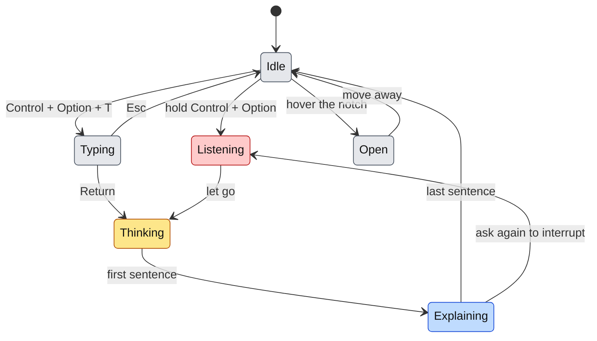
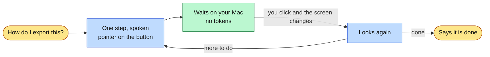
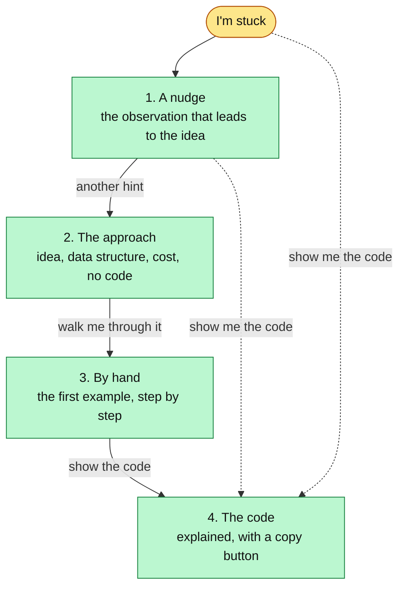

# Using Buddy

Buddy is a study helper, not a tutor: it explains, draws, remembers and walks you through apps, and it never quizzes or grades.

## Asking

Hold **Control + Option**, ask out loud, and let go. Your words appear under the notch as you speak, so a misheard question can be caught before it is sent. The answer starts within a few seconds: each sentence is spoken with the marks that go with it.

**Typing instead.** Press **Control + Option + T** from any app, or open the notch and click the chat box, then press Return. Shift + Return starts a new line, and Esc puts the box away with what you typed kept for later. A typed question is answered exactly like a spoken one, out loud and drawn on the screen, and both land in the chat tab, which holds the whole day's conversation. The notch closes when you send so the drawing has the whole screen, and the keyboard goes back to the app you were in. Questions can be up to 2,000 characters, enough for a pasted function or error message.

The dot in the notch follows the same colours: grey ready, red listening, amber thinking, blue explaining, and green "your turn" while it waits for you to do a step in an app. While it thinks, the notch also says which model is answering.

## Good questions

Ask about what is on screen, in your own words. Buddy reads the screen, so "this" and "that line" work.

| Ask | Buddy |
|---|---|
| "why does this crash on the last element" | marks the line and walks the failing case |
| "teach me how consistent hashing works properly" | builds a lesson on a card, step by step |
| "should I use Kafka or a queue here" | gives the verdict first, then the reason |
| "I didn't get that" | explains again from a completely different angle |
| "what's a trie" | answers in a sentence or two |
| "how do I export this as a PDF" | points at the first step, then guides you through the rest |

## Learning an app, step by step

Ask how to get something done in the app in front of you, "how do I add a transition here" or "where do I turn on dark mode", and Buddy guides instead of lecturing: it says one step and points at the exact button or menu. Do the step and Buddy notices and says the next one, without being asked, until the task is done. The step it is waiting for shows under the notch; Esc, Stop or a new question ends the guide.

Watching costs nothing. Buddy only looks after you click, type or scroll, and compares a tiny thumbnail of the screen on your Mac; the model is asked again only when the screen has changed, which is one ordinary answer, the same as asking "what next?". A guide stops by itself after 15 steps or 5 minutes without progress.

If you go the wrong way, the next step says how to get back. If you are mid-step, still typing a name, it stays quiet and keeps waiting. Switching to another app to reply to a message does not count as doing the step.

## The notch

- **Idle**, it disappears into the camera housing.
- **While answering**, it widens to show what is being said.
- **While guiding**, it shows the step it is waiting for, with "esc to stop".
- **Hover it** for the last lesson as a paper card (title, your question, the answer, follow-ups), the chat with the whole day's conversation and the box to type in, and Settings.

Every conversation is also saved as a Markdown file per day in `~/Library/Application Support/ClickyLocal/Transcripts`, opened from the notch with **Open full transcript**.

## Follow-ups

After an answer, the buttons under it ask the most useful next question ("show me the code", "what if the cache dies?") or copy code it offered. Tapping one is the same as asking it.

## Practice problems: hints before answers

On LeetCode, HackerRank, NeetCode and similar sites, Buddy helps in steps, so you still get to solve it.

Saying "show me the code" at any point skips straight there. A question about a concept on the problem page ("what's a heap") is answered normally, without giving the problem away. Your step on each problem is remembered for two days.

## Your own diagrams

Drawing a design in Excalidraw, draw.io, Miro, Freeform or any whiteboard app, ask "what am I missing?" Buddy talks it through like a peer at the whiteboard: it marks your own boxes, and draws anything it would add as a dashed purple box beside where it belongs. It never scores the design.

## Learning memory

Buddy remembers the ideas it explains, across days. When a new question touches one, the answer builds on it ("the same trade-off as the consistent hashing from Tuesday"), and the lesson card shows **Builds on** with the idea's name. If you said you did not follow an explanation, the next one uses a different example.

Memory keeps only the latest explanation of each idea, estimates how well you still remember it, and sets aside ideas met once and unseen for months. It stays on this Mac. Turn it off or **Forget all** in Settings.

## Settings

Hover the notch and open the gear tab.

| Setting | What it does |
|---|---|
| Brain | **Auto** picks Sonnet, Opus or Argon per question; or always use Claude, Gemini, or a local model |
| Sounds | Soft tones when the mic opens and a question is sent, a water drop when the notch opens |
| Learning memory | On or off, how many ideas are remembered, Forget all |
| Name and API keys | Reopens setup on the keys |
| Open at login | Whether Buddy starts when you log in |
| Check for updates | The daily check for a newer Buddy, and Check now |

## Shortcuts

| Keys | Does |
|---|---|
| Hold Control + Option | Ask out loud |
| Control + Option + T | Type a question |
| Return / Shift + Return, in the chat box | Send / new line |
| Esc | Clear the drawing, stop a walkthrough, or put the chat box away |
| Stop, in the notch | Silence the voice |
